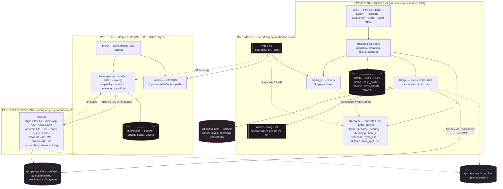
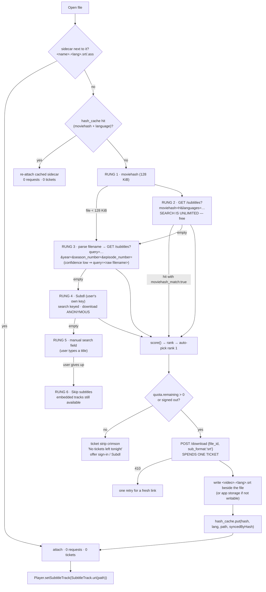
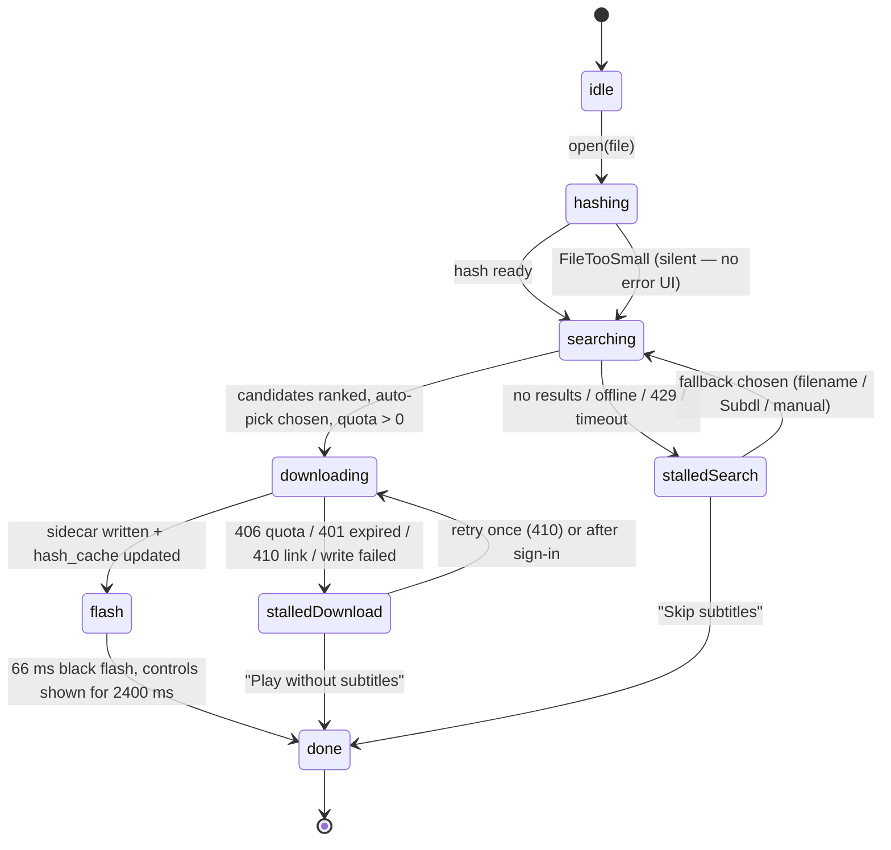

# Marquee — ARCHITECTURE

**Project:** 08 · The No-Hassle Smart Media Player (codename *Marquee*, design system **HOUSE LIGHTS**)
**Written:** 2026-09-06 · **Status:** Planned — not started
**Binding inputs:** `_shared/DECISIONS.md` (D1 Marquee exception, D2 hosting + mandatory Worker, D3 Android signing recipe, D5 licensing, D6 repo layout, D7 token contract, D9 working agreement), `docs/RESEARCH.md` (verified stack, API facts, verification log), `docs/DESIGN.md` (tokens, motion, screens), `docs/TESTING.md` (golden data — every algorithm below has a fixture table there), `GOAL.md` (success criteria).

**Declared deviations from DECISIONS.** Two, both already sanctioned by D1's Marquee exception and expanded here:
1. **Native tier is Flutter + media_kit, not Vite/React + Capacitor.** libmpv is the only engine that gives an identical codec/subtitle matrix on Windows *and* Android (RESEARCH §5.1). Consequence: `npx cap add android` is never run; there is no `android/` Capacitor shell; Zustand/Dexie/Motion/React Router do not exist in this repo's native tier.
2. **Web tier is Vite + TypeScript with no framework** (D1 assumes React 19). Marquee Lite is one screen with a `<video>` element, a leader and a sheet; a framework would cost ~45 KB gz for nothing. The D7 token contract, the Tailwind-free hand-written CSS, `vite-plugin-pwa` and Vitest/Playwright all stay.

Everything else — GitHub Pages, the Cloudflare Worker, Biome, npm, the token names, "day 1 = live", "engine first" — is unchanged.

---

## 1. Stack

### 1.1 Native tier (Windows 11 x64 + Android 8.0+)

| Layer | Choice & version | Why this, here |
|---|---|---|
| Framework | **Flutter stable 3.47.x** (pinned in `.fvmrc` and in CI) | One codebase → Windows exe + APK; Impeller gives fragment shaders on both, which HOUSE LIGHTS needs for the beam |
| Player core | **`media_kit ^1.2.6` + `media_kit_video ^2.0.1` + `media_kit_libs_video ^1.0.7`** (libmpv = ffmpeg + libass) | Identical decoder set both platforms; D3D11VA on Windows, MediaCodec on Android; MIT wrapper over LGPL natives (RESEARCH §2, verification log #4) |
| Subtitle rendering | **libass inside libmpv** via `PlayerConfiguration(libass: true, libassAndroidFont: …, libassAndroidFontName: 'Noto Sans')` | Full ASS/SSA typesetting; identical on both platforms. Never set `vo: 'mediacodec_embed'` — mpv disables subtitle rendering there |
| Local DB | **`drift ^2.34.4`** + `drift_flutter` + `sqlite3_flutter_libs` | Typed SQL, migrations, `NativeDatabase.memory()` for tests. *(Not `isar` — last stable is 3 years old, RESEARCH verification log)* |
| State | **`flutter_riverpod ^3`** (MIT) | Compile-safe DI + `AsyncValue` maps 1:1 onto the leader's phase/stall model; testable without a widget tree. Pin the exact version at scaffold time (Phase 0 commits `pubspec.lock`) |
| HTTP | **`http`** + `package:http/testing.dart` `MockClient` | Tiny; the mock client is what TESTING §1 assumes |
| Secrets | **`flutter_secure_storage`** | OpenSubtitles JWT and the optional Subdl key. The password is never stored |
| Colour extraction | **`material_color_utilities`** (Apache-2.0, used by Flutter itself) | `QuantizerCelebi` + `Score` for the bias light. *(Not `palette_generator` — discontinued)* |
| Files | **`file_picker`** (SAF on Android, native dialog on Windows) | Also gives persisted directory grants for the library |
| Windows chrome | **`window_manager` ^0.5.2** + **`flutter_acrylic` ^1.1.4** | Frameless window, the marquee *is* the title bar; Mica in the Lobby only |
| Device | **`wakelock_plus`**, **`screen_brightness`** | Keep-screen-on during playback; per-app brightness for the left edge dimmer, restored on exit |
| Motion / vector | **`flutter_animate` ^4.5.2** (BSD-3), **`flutter_svg`** (MIT) for the Lucide subset, **`rive` ^0.14.11** (MIT, v1 stretch) | Auto-hide, shimmer, staggered rails; icons as assets keeps the licence trail explicit |
| Sound | **`flutter_soloud`** (MIT) | Room tone loop + synthesised sweep/2-pop/detent (no assets for the synthesised ones) |
| Determinism | **`clock`** | `withClock(Clock.fixed(...))` — sky band, night flicker, quota reset countdown (TESTING §1) |
| Shaders | Flutter **`FragmentProgram.fromAsset`** (GLSL 460 → Impeller) | `assets/shaders/beam.frag`, `grain.frag` |
| Lint / format | `flutter_lints` + `dart format` | Biome covers `web/` and `worker/` only |

### 1.2 Web tier — "Marquee Lite"

| Layer | Choice & version | Why |
|---|---|---|
| Build | **Vite 8 + TypeScript 5 (strict)**, `vanilla-ts` template | One screen; no framework earns its bytes (see deviation #2) |
| Styling | Hand-written CSS + `src/styles/tokens.css` (D7 names, DESIGN §15 values) | Generated together with `tokens.dart` by `scripts/tokens.mjs` |
| Playback | `<video>` + `URL.createObjectURL(file)`; capability probe from `canPlayType` + `VideoDecoder.isConfigSupported` | Codec reach is a browser property — the UI says so honestly |
| ASS/SSA | **`jassub ^2.5.16`**, lazy-loaded only when a `.ass`/`.ssa` is attached | ~1.2 MB WASM must never be in the first paint |
| SRT | Own `srt2vtt.ts` → `<track>` (Blob URL) | 60 lines, no dependency; the same parser as `srt.dart` |
| Stretch decode path | **`movi-player ^0.4.0`** (Apache-2.0) *or* **`mediabunny ^1.55`** (MPL-2.0), dynamic `import()` behind the "Try the WebCodecs path" button | Young libraries (RESEARCH §4) — never on the critical path |
| PWA | **`vite-plugin-pwa` 1.x** (Workbox) — precache the shell, tokens, fonts; runtime-cache nothing from the Worker | "Works on the train": a previously fetched sidecar in IndexedDB still attaches offline |
| Storage | **IndexedDB** (own ~80-line wrapper over `idb`-style promises; no Dexie — one object store per entity) | Session, subtitle cache keyed by `moviehash+lang`, sync offsets |
| Sound | **Howler.js** (MIT) + Web Audio synthesis | Same event list as native (DESIGN §12) |
| Test | Vitest (`happy-dom`) + `@testing-library/dom` + Playwright (chrome / firefox / pixel-7) + `@axe-core/playwright` | TESTING §1 |

### 1.3 Proxy tier — `marquee-proxy`

| Layer | Choice | Why |
|---|---|---|
| Runtime | **Cloudflare Workers, Free plan** (100k req/day, 10 ms CPU, hard-fails with error 1027, never bills) | **Mandatory, not optional**: `api.opensubtitles.com` answers CORS preflight `OPTIONS` with **403 and no `Access-Control-Allow-Headers`**, and the custom `Api-Key` header always triggers a preflight (RESEARCH verification log #8). A browser can therefore never call the API directly |
| Language | TypeScript, single `index.ts`, no dependencies | 10 ms CPU budget; every dependency is a risk |
| Deploy | `cloudflare/wrangler-action@v4` from `.github/workflows/worker.yml` (shared template) | Secrets via `wrangler secret put`, never in git |
| Test | `@cloudflare/vitest-pool-workers` (`SELF.fetch`, `fetchMock`) + a nightly contract test against the live API | TESTING §1 |

### 1.4 CI/CD

| Job | Runner | Produces |
|---|---|---|
| `ci.yml` | `ubuntu-24.04` | `flutter analyze`, `flutter test` (unit + widget + goldens), `web` Vitest + Playwright, `worker` Vitest, `scripts/tokens.mjs && git diff --exit-code` |
| `pages.yml` | `ubuntu-24.04` | Marquee Lite → GitHub Pages, `base = /marquee/` |
| `worker.yml` | `ubuntu-24.04` | `wrangler deploy` on changes under `worker/**` |
| `release.yml` | `windows-latest` + `ubuntu-24.04` + a publish job | `marquee-<version>-windows-x64.zip`, `marquee-<version>-arm64-v8a.apk` (+ armeabi-v7a, x86_64), `SHA256SUMS.txt` on a GitHub Release. Every asset carries the version segment; the raw Flutter names (`app-arm64-v8a-release.apk`) are renamed before upload and must never appear on a Release |
| `contract.yml` | `ubuntu-24.04`, nightly | Live OpenSubtitles shape check (skipped when `OS_API_KEY` is absent) |

Pinned per DECISIONS D3: `actions/checkout@v7`, `actions/setup-node@v7` (Node 22), `actions/setup-java@v6` (**Temurin 17** — this is a Flutter + AGP project, not Capacitor; 17 is the version proven by Mangayomi/Kazumi with this Flutter/AGP/Gradle triple, and `compileOptions`/`kotlinOptions` in `android/app/build.gradle.kts` are pinned to `JavaVersion.VERSION_17` to match. D3 pins Java **21** because Capacitor 8 targets it; Marquee is not a Capacitor project, so this is the declared deviation from D3. If a future AGP demands 21, move `setup-java`, `compileOptions`, `kotlinOptions` and this sentence in one commit), `subosito/flutter-action@v2`, `softprops/action-gh-release@v3`, `compileSdk 36`, `minSdk 26`, `--split-per-abi`.

---

## 2. System diagram



**The one-sentence read:** the native tier talks to OpenSubtitles directly with a `--dart-define`d consumer key; the web tier cannot (CORS preflight 403) so it talks to the Worker, which holds the key; both run the *same* engine algorithms, and TESTING's golden tables are shared between the Dart and TypeScript implementations so the two can never drift.

---

## 3. Folder layout

DECISIONS §D6 describes a Vite repo. Marquee keeps D6's *spirit* — `engine/` is framework-free and 100 % unit-tested, `data/` carries attribution, secrets live in `worker/` — but the root is a Flutter app.

```
marquee/
├── .github/workflows/
│   ├── ci.yml                    # analyze + all three test suites + tokens drift check
│   ├── pages.yml                 # web/ -> GitHub Pages (from _shared/templates/pages.yml)
│   ├── worker.yml                # wrangler deploy (from _shared/templates/worker.yml)
│   ├── release.yml               # tag v* -> Windows zip + split-per-ABI APKs -> Release
│   └── contract.yml              # nightly live-API shape check
├── lib/
│   ├── main.dart                 # ProviderScope, window_manager bootstrap, MediaKit.ensureInitialized()
│   ├── app.dart                  # routes (Lobby / Threading / Auditorium / Booth / TicketOffice), theme
│   ├── engine/                   # PURE DART — no flutter imports, no io beyond dart:io RandomAccessFile
│   │   ├── hash.dart             # moviehash (§6.1)
│   │   ├── filename.dart         # parse-torrent-title port (§6.2)
│   │   ├── scoring.dart          # candidate ranking (§6.3)
│   │   ├── threading.dart        # leader state machine (§6.5)
│   │   ├── tickets.dart          # quota -> ticket-strip model (§6.9)
│   │   ├── timecode.dart         # folio strings (§6.8)
│   │   ├── sync_rule.dart        # 50 ms detents, clamp, per-hash memory (§6.6)
│   │   ├── detents.dart          # chapter / 5-min gate detents (§6.7)
│   │   ├── bias_light.dart       # house-lights colour extraction (§6.4)
│   │   ├── srt.dart              # SRT parse / shift / write-beside-file
│   │   └── models/               # the data classes in §5 (immutable, no framework)
│   ├── api/
│   │   ├── opensubtitles.dart    # REST v1 client: sorted params, headers, 401/406/410/429
│   │   ├── subdl.dart            # fallback: keyed search, ANONYMOUS zip download
│   │   ├── tmdb.dart             # optional /find + image URLs, 6-month cache cap
│   │   └── net.dart              # retry/backoff, Retry-After, X-RateLimit-* parsing
│   ├── db/
│   │   ├── database.dart         # drift @DriftDatabase, schemaVersion, migrations
│   │   ├── tables.dart           # MediaFiles, HashCache, ResumePoints, SyncOffsets, Artwork, Folders
│   │   └── daos/
│   ├── player/
│   │   ├── engine.dart           # media_kit Player/VideoController lifecycle, mpv property bridge
│   │   ├── tracks.dart           # embedded audio/subtitle track listing + switching
│   │   └── screenshot.dart       # frame grab -> bias_light input (throttled)
│   ├── platform/                 # windows vs android adapters behind one interface
│   │   ├── files.dart            # picker, SAF persisted grants, "is the folder writable?"
│   │   ├── pip.dart              # MethodChannel('marquee/pip')        -> Kotlin
│   │   ├── mediastore.dart       # MethodChannel('marquee/mediastore') -> Kotlin
│   │   └── window.dart           # frameless window, Mica, title-bar drag (Windows)
│   ├── state/                    # Riverpod providers (§7)
│   ├── ui/
│   │   ├── lobby/ threading/ auditorium/ booth/ ticket_office/
│   │   └── components/           # marquee_sign, bulb, beam, leader, ticket_strip,
│   │                             # film_gate, sync_rule, candidate_row, folio, booth_sheet
│   └── theme/
│       └── tokens.dart           # GENERATED by scripts/tokens.mjs — never edited by hand
├── assets/
│   ├── fonts/                    # BigShouldersDisplay[wght].ttf, Geist[wght].ttf,
│   │                             # GeistMono[wght].ttf, NotoSans-Regular.ttf, NotoSans-Bold.ttf
│   ├── shaders/                  # beam.frag, grain.frag
│   ├── icons/                    # Lucide SVG subset (ISC)
│   └── sounds/                   # projector-loop.ogg, ticket-tear.ogg (CC0)
├── android/                      # generated by `flutter create` — NOT Capacitor
│   └── app/src/main/kotlin/com/rahul/marquee/
│       ├── MainActivity.kt       # + PiP callbacks, enableOnBackInvokedCallback
│       ├── PipChannel.kt         # ~60 lines
│       └── MediaStoreChannel.kt  # ~150 lines: query video collection, pages of 500
├── windows/                      # generated by `flutter create`
├── integration_test/             # player · subtitles · seek · keyboard · house · perf
├── test/                         # engine, db, widgets, goldens, theme (TESTING §2)
├── web/                          # Marquee Lite
│   ├── index.html
│   ├── src/
│   │   ├── main.ts
│   │   ├── engine/               # osHash.ts, srt2vtt.ts, scoring.ts, capability.ts,
│   │   │                         # tickets.ts, timecode.ts, syncRule.ts, api.ts (Worker client)
│   │   ├── ui/                   # lite.ts, leader.ts, gate.ts, booth.ts, noPrint.ts
│   │   ├── storage/idb.ts
│   │   └── styles/tokens.css     # GENERATED
│   ├── public/                   # manifest, icons, LICENSES/
│   ├── e2e/                      # Playwright specs incl. visual/ and perf/
│   └── vite.config.ts
├── worker/
│   ├── index.ts                  # §9.4
│   ├── wrangler.toml
│   └── test/                     # worker.test.ts, contract.test.ts, fixtures/*.json
├── scripts/
│   ├── tokens.mjs                # DESIGN §15 -> web/src/styles/tokens.css + lib/theme/tokens.dart
│   └── make-fixtures.sh          # bit-exact ffmpeg media fixtures (TESTING §2.2)
├── design/preview.html           # the visual contract (D9.3)
├── docs/                         # GOAL is at the repo root; ARCHITECTURE, PLAN, DESIGN,
│                                 # RESEARCH, TESTING, DEPLOYMENT live here
├── LICENSES/                     # LGPL-2.1, LGPL-3.0, ISC, OFL texts + build-script links
├── LICENSE                       # MIT (Marquee's own code)
└── README.md
```

Rule inherited from D9.2: **nothing in `lib/engine/` may `import 'package:flutter/…'`**. A `test/engine/no_flutter_imports_test.dart` greps the folder and fails the build if it does — that is what keeps the Dart and TypeScript engines swappable and the goldens shared.

---

## 4. Data model — Dart (native tier)

All engine models are immutable, `const`-constructible, and have `fromJson`/`toJson` where they cross the API or DB boundary. `lib/engine/models/`.

```dart
// ─────────────────────────── identity & media ───────────────────────────

/// 16 lowercase hex chars. A value type so it can never be confused with a path.
extension type const MovieHash(String value) {
  static final _re = RegExp(r'^[0-9a-f]{16}$');
  bool get isValid => _re.hasMatch(value);
}

enum MediaOrigin { localPath, contentUri, commandLine, browserFile }

class MediaFile {
  final int? id;                    // drift row id, null before insert
  final String locator;             // Windows path OR Android content:// URI
  final String displayName;         // basename, used by the filename parser
  final int sizeBytes;
  final MovieHash? moviehash;       // null when sizeBytes < 131072
  final MediaOrigin origin;
  final String? container;          // 'matroska', 'mov,mp4,...' from mpv `file-format`
  final int? durationMs;
  final double? fps;                // mpv `container-fps` — used by scoring (§6.3)
  final int? width, height;
  final String? videoCodec, audioCodec;
  final DateTime addedAt;
  final DateTime? lastPlayedAt;
  const MediaFile({...});
}

class Chapter { final int index; final double startSeconds; final String? title; }

class ResumePoint {                 // one per MovieHash (survives a file move/rename)
  final MovieHash hash; final int positionMs; final int durationMs; final DateTime at;
  double get fraction => durationMs == 0 ? 0 : positionMs / durationMs;
  bool get finished => fraction > 0.97;
}

// ─────────────────────────── filename grammar ───────────────────────────

enum NameConfidence { high, medium, low }   // low ⇒ send the RAW filename as `query`
enum FeatureKind { movie, episode }

class ParsedName {
  final String title;               // cleaned: dots/underscores → spaces, trimmed
  final int? year;
  final int? season, episode;
  final String? resolution;         // '1080p'
  final String? source;             // 'BluRay' | 'WEB-DL' | 'WEB' | 'HDTV' | 'DVDRip'
  final String? videoCodecToken;    // VERBATIM token: 'x264' ≠ 'H264' (see §6.3 note)
  final String? group;              // 'AMIABLE'
  final bool remastered, proper, extended;
  final FeatureKind kind;
  final NameConfidence confidence;
  final String raw;                 // the original filename, for `query=<raw>`
  const ParsedName({...});
}

// ─────────────────────────── subtitle providers ─────────────────────────

enum SubtitleProvider { openSubtitles, subdl, embedded, sidecar }

class FeatureDetails {
  final String featureType;         // 'Movie' | 'Episode'
  final String? title; final int? year;
  final int? seasonNumber, episodeNumber;
  final int? imdbId;                // 41959 (== tt0041959)
  final int? tmdbId;                // 1092
  const FeatureDetails({...});
}

class SubtitleCandidate {
  final SubtitleProvider provider;
  final String id;                  // OS: files[0].file_id as String; Subdl: the `url` path
  final String language;            // ISO 639-1 lowercase: 'en'
  final String? release;            // 'The.Third.Man.1949.1080p.BluRay.x264-AMIABLE'
  final int downloadCount;
  final bool hearingImpaired;
  final bool moviehashMatch;
  final bool machineTranslated, aiTranslated;
  final double? fps;
  final DateTime? uploadDate;
  final FeatureDetails? feature;
  const SubtitleCandidate({...});
}

/// Output of scoring.dart — never mutates the candidate.
class ScoredCandidate {
  final SubtitleCandidate candidate;
  final double score;
  final List<String> reasons;       // ['hash +1000','group +200','fps +40','downloads +4.09']
  final bool autoPick;              // false for machine/AI translated, always
  const ScoredCandidate({...});
}

/// What is actually attached to the player right now.
sealed class SubtitleTrackRef { const SubtitleTrackRef(); }
class NoSubtitle       extends SubtitleTrackRef { const NoSubtitle(); }
class EmbeddedSubtitle extends SubtitleTrackRef { final int mpvTrackId; final String? language, title; }
class ExternalSubtitle extends SubtitleTrackRef {
  final String path;                // sidecar written beside the file, or app storage
  final String language;
  final SubtitleProvider provider;
  final bool syncedByHash;          // true ⇒ green MATCH bulb; false ⇒ 'BY NAME · CHECK SYNC'
  final String? release;
}

class SyncOffset { final MovieHash hash; final int delayMs; }   // +ve = subtitles appear later

// ─────────────────────────── quota / tickets ────────────────────────────

enum TicketState { anonymous, nLeft, twoLeft, exhausted, vip, unknown }

class Quota {
  final int? remaining;             // from /download response or login
  final int? total;                 // login `allowed_downloads` — NEVER a constant (10 vs 20 dispute)
  final DateTime? resetUtc;
  final bool signedIn, vip;
  final String? level;              // 'Sub leecher'
  TicketState get state => !signedIn ? TicketState.anonymous
      : vip ? TicketState.vip
      : remaining == null ? TicketState.unknown
      : remaining! <= 0 ? TicketState.exhausted
      : remaining! <= 2 ? TicketState.twoLeft
      : TicketState.nLeft;
  const Quota({...});
}

class TicketStrip {                 // pure view model produced by tickets.dart (§6.9)
  final String text;                // '7 OF 10 TONIGHT · RESETS 00:00 UTC'
  final String? sentence;           // the one-line explanation, or null
  final String ariaLabel;
  final TicketState state;
  final bool pendingTear;           // count decrements AFTER ticket-tear completes (DESIGN §7 #9)
}

// ─────────────────────────── the leader ─────────────────────────────────

enum LeaderPhase { idle, hashing, searching, downloading, flash, done }

sealed class LeaderEvent { const LeaderEvent(); }
class Stalled extends LeaderEvent {
  final LeaderPhase at;
  final ThreadingFailure failure;
  final List<FallbackAction> next;   // filenameSearch, subdl, manualSearch, skip, signIn, retry
}

enum ThreadingFailure {
  fileTooSmall,      // < 128 KiB — NOT an error: skip the hash, go straight to filename search
  offline, timeout, noResults, unauthorized /*401*/, quotaExhausted /*406*/,
  rateLimited /*429*/, linkExpired /*410*/, writeFailed, decodeFailed, cancelled,
}

class ThreadingState {
  final LeaderPhase phase;
  final double sweep;                // 0..1, drives the conic-gradient mask
  final MovieHash? hash;
  final ParsedName? parsed;
  final List<ScoredCandidate> candidates;
  final ScoredCandidate? picked;
  final SubtitleTrackRef attached;
  final Quota quota;
  final LeaderEvent? event;          // non-null ⇒ the sweep is FROZEN at `sweep`
}

// ─────────────────────────── ambience & settings ────────────────────────

class BiasStops {                    // house-lights output (§6.4); null ⇒ keep --focus at 6 %
  final List<int> argb;              // exactly 5, ordered by population then darkened duplicates
  final DateTime sampledAt;
}

enum LibraryScanMode { none, folders, mediaStore }

class Settings {
  final List<String> languages;      // max 3, ISO 639-1, ordered by preference
  final bool preferHearingImpaired;
  final bool saveBesideFile;
  final bool subdlEnabled;           // user's own key, stored in secure storage
  final bool tmdbEnabled;
  final bool roomTone, biasLight, beam, sounds, haptics;
  final ThemeMode lobbyTheme;        // auto | auditorium | matinee — playback is ALWAYS auditorium
  final String hwdec;                // 'auto-safe' | 'no'
  final String? glslShaderPreset;    // Windows only, e.g. 'anime4k-clamp'
  final LibraryScanMode scanMode;
  const Settings({...});
}
```

**drift tables** (`lib/db/tables.dart`, `schemaVersion: 1`) — all generated by `dart run build_runner build --delete-conflicting-outputs`; `lib/db/database.g.dart` is gitignored and rebuilt in CI:

| Table | Columns | Notes |
|---|---|---|
| `media_files` | `id` PK, `locator` UNIQUE, `display_name`, `size_bytes`, `moviehash` (nullable, INDEXED), `origin`, `container`, `duration_ms`, `fps`, `width`, `height`, `video_codec`, `audio_codec`, `added_at`, `last_played_at` | `locator` is a path or a `content://` URI |
| `hash_cache` | PK (`moviehash`, `language`), `provider`, `file_id`, `release`, `sidecar_path`, `synced_by_hash`, `fetched_at` | **The ticket-saver.** Consulted before any network call; a hit costs 0 downloads |
| `resume_points` | PK `moviehash`, `position_ms`, `duration_ms`, `at` | Keyed by hash so a moved/renamed file still resumes |
| `sync_offsets` | PK `moviehash`, `delay_ms` | Per-file subtitle delay memory; surfaces as the `±0.35` badge in the Lobby |
| `folders` | `id` PK, `locator`, `grant_blob` (SAF persisted URI), `last_scan_at` | Windows: plain paths. Android: persisted tree URIs |
| `artwork` | PK `tmdb_id`, `poster_path`, `backdrop_path`, `accent_argb`, `fetched_at`, `expires_at` | `expires_at = fetched_at + 180 days` — **enforced**, TMDB terms cap caching at 6 months |
| `search_cache` | PK (`query_key`), `body_json`, `fetched_at` | 24 h TTL on *search* responses only (search is unlimited, but politeness + offline) |
| `app_state` | PK `key` TEXT, `value_json` TEXT | The small key/value store the other seven tables have no shape for. Three keys are defined at v1.0.0: **`settings`** (the serialised `Settings` class above — it is described nowhere else and has to live somewhere), **`window_bounds`** (`{x,y,w,h,maximized}` — DEPLOYMENT §9 and TESTING W-I5 both require the Windows window to persist size and position between runs) and **`seen_gate_nudge`** (`true` once the film-gate nudge has fired — PLAN 3.4's acceptance is that it fires **once** and is remembered). No `shared_preferences`: one store, one migration path |

There are therefore **eight** tables. `app_state` is written through a tiny typed facade, never raw — the same keys appear in the §5.5 export/import format so a backup restores the window geometry and the nudge flag along with everything else.

`search_cache.query_key` is the alphabetically-sorted query string (§9.1) so it matches the exact request the client would have made.

---

## 5. Data model — TypeScript (web tier + Worker)

`web/src/engine/types.ts` is the single source; `worker/index.ts` imports the wire types only (it must stay dependency-free, so they are duplicated by a `scripts/tokens.mjs`-style copy step guarded by a CI diff check).

```ts
// ── wire shapes: exactly what api.opensubtitles.com/api/v1 returns (only the fields we read) ──

export interface OsFile { file_id: number; cd_number?: number; file_name?: string }

export interface OsFeatureDetails {
  feature_type: 'Movie' | 'Episode' | string
  title?: string; year?: number
  season_number?: number | null; episode_number?: number | null
  imdb_id?: number | null; tmdb_id?: number | null
}

export interface OsSubtitleAttributes {
  language: string | null            // 'en'
  download_count: number
  new_download_count?: number
  hearing_impaired: boolean
  machine_translated: boolean
  ai_translated: boolean
  fps: number | null
  release: string | null
  upload_date?: string
  moviehash_match?: boolean          // ABSENT unless the search included a moviehash
  files: OsFile[]
  feature_details: OsFeatureDetails
}

export interface OsSearchResponse {
  total_pages: number; total_count: number; page: number
  data: Array<{ id: string; type: 'subtitle'; attributes: OsSubtitleAttributes }>
}

export interface OsLoginResponse {
  token: string
  base_url: string                   // 'api.opensubtitles.com' | 'vip-api.opensubtitles.com'
  status: number
  user: { allowed_downloads: number; level: string; user_id: number; ext_installed?: boolean; vip: boolean }
}

export interface OsDownloadResponse {
  link: string                       // TEMPORARY: store the FILE, never this URL (410 after expiry)
  file_name: string
  requests: number
  remaining: number
  message?: string
  reset_time?: string                // '08 hours and 16 minutes'
  reset_time_utc: string             // ISO — the only reset value the UI trusts
}

// ── engine types (mirror the Dart classes 1:1 so the goldens are shared) ──

export type MovieHash = string & { readonly __brand: 'MovieHash' }
export type Provider = 'opensubtitles' | 'subdl' | 'embedded' | 'sidecar'

export interface Candidate {
  provider: Provider
  id: string
  language: string
  release: string | null
  downloadCount: number
  hearingImpaired: boolean
  moviehashMatch: boolean
  machineTranslated: boolean
  aiTranslated: boolean
  fps: number | null
  feature: OsFeatureDetails | null
}

export interface ScoredCandidate { candidate: Candidate; score: number; reasons: string[]; autoPick: boolean }

export interface ParsedName {
  title: string; year: number | null
  season: number | null; episode: number | null
  resolution: string | null; source: string | null
  videoCodecToken: string | null; group: string | null
  remastered: boolean; proper: boolean; extended: boolean
  kind: 'movie' | 'episode'
  confidence: 'high' | 'medium' | 'low'
  raw: string
}

export type TicketState = 'anonymous' | 'n-left' | 'two-left' | 'exhausted' | 'vip' | 'unknown'
export interface Quota { remaining: number | null; total: number | null; resetUtc: string | null
                         signedIn: boolean; vip: boolean; level: string | null }
export interface TicketStrip { text: string; sentence: string | null; ariaLabel: string
                               state: TicketState; pendingTear: boolean }

export type LeaderPhase = 'idle' | 'probing' | 'hashing' | 'searching' | 'downloading' | 'flash' | 'done'
export type ThreadingFailure =
  | 'file-too-small' | 'offline' | 'timeout' | 'no-results' | 'unauthorized' | 'quota-exhausted'
  | 'rate-limited' | 'link-expired' | 'undecodable' | 'no-codec' | 'cancelled'

export interface ThreadingState {
  phase: LeaderPhase; sweep: number            // 0..1; frozen while `failure` is set
  hash: MovieHash | null; parsed: ParsedName | null
  candidates: ScoredCandidate[]; picked: ScoredCandidate | null
  quota: Quota; failure: ThreadingFailure | null
  next: Array<'filename-search' | 'subdl' | 'manual' | 'skip' | 'sign-in' | 'webcodecs' | 'retry'>
}

// ── web-only: what the browser can actually play (DESIGN §9.6) ──

export interface CodecSupport { label: string; ok: boolean; via: 'native' | 'webcodecs' | 'none' }
export interface Capability {
  line: string                       // 'MP4/H.264 ✓ · WebM/VP9 ✓ · AV1 ✓ · HEVC ✗ · AC-3 ✗ · MKV partial'
  codecs: CodecSupport[]
  webCodecsAvailable: boolean
}

// ── Worker contract (§9.4) ──

export interface WorkerError { error: string; sentence: string; retryAfterSeconds?: number }
export interface WorkerMeta {                 // mirrored into response headers, not the body
  'x-ratelimit-remaining'?: string; 'retry-after'?: string
}

// ── IndexedDB records (web tier) ──

export interface CachedSubtitle {             // key: `${hash}|${lang}`
  hash: MovieHash; language: string; provider: Provider
  release: string | null; syncedByHash: boolean
  vttText: string                             // stored converted, so offline reattach is instant
  bytes: number; fetchedAt: number
}
export interface StoredOffset { hash: MovieHash; delayMs: number }
export interface LiteSession { jwt: string | null; jwtExpiresAt: number | null; quota: Quota
                               languages: string[]; preferHearingImpaired: boolean }
```

The JWT in `LiteSession` is stored **encrypted at rest**: a non-extractable AES-GCM key is generated with WebCrypto, kept in its own IndexedDB store, and the token is sealed with it (DECISIONS §D4's key-storage rule, applied here to a session token). A "this session only" switch keeps it in memory instead.

---

## 6. Key algorithms

Every algorithm below has a golden table in `docs/TESTING.md`; the section reference is given so the two files stay welded together.

### 6.1 The moviehash (`hash.dart` / `osHash.ts`) — TESTING §2.1

**Spec** (public, https://opensubtitles.github.io/oshash/): `hash = (fileSize + Σ le_u64(first 64 KiB) + Σ le_u64(last 64 KiB)) mod 2⁶⁴`, printed as 16 lowercase hex digits, zero-padded. Files **< 128 KiB are rejected by the service** — that is not an error in Marquee, it is a branch (skip to filename search, DESIGN §9.2).

Cost: 131 072 bytes of I/O and 16 384 additions — under 40 ms on any disk, which is why the leader's "3" is a real phase and not theatre.

```dart
// lib/engine/hash.dart — Dart VM ints are 64-bit two's complement and WRAP on overflow,
// which is exactly the arithmetic the spec asks for. `toUnsigned(64)` stops a negative
// wrap from printing a '-'.
class FileTooSmall implements Exception { final int size; const FileTooSmall(this.size); }

const int kChunk = 65536;
const int kMinSize = 2 * kChunk;   // 131072

Future<MovieHash> movieHashOf(RandomAccessFile raf, int sizeBytes) async {
  if (sizeBytes < kMinSize) throw FileTooSmall(sizeBytes);

  Future<int> chunkSum(int offset) async {
    await raf.setPosition(offset);
    final bytes = await raf.read(kChunk);
    if (bytes.length != kChunk) throw StateError('short read at $offset');
    final bd = ByteData.sublistView(bytes);
    var s = 0;
    for (var i = 0; i < kChunk; i += 8) {
      s += bd.getUint64(i, Endian.little);   // wraps at 2^64 — intended
    }
    return s;
  }

  final head = await chunkSum(0);
  final tail = await chunkSum(sizeBytes - kChunk);   // NOT aligned to a chunk boundary
  final h = (sizeBytes + head + tail).toUnsigned(64);
  return MovieHash(h.toRadixString(16).padLeft(16, '0'));
}
```

```ts
// web/src/engine/osHash.ts — JS numbers cannot hold 64 bits, so BigInt + an explicit mask.
// Blob.slice() + arrayBuffer() reads ONLY the two chunks; a 40 GB file never enters memory.
const CHUNK = 65536, MIN = 2 * CHUNK, MASK = 0xffff_ffff_ffff_ffffn;

export async function osHash(file: Blob): Promise<MovieHash> {
  if (file.size < MIN) throw new RangeError('FILE_TOO_SMALL');
  const sum = async (b: Blob): Promise<bigint> => {
    const dv = new DataView(await b.arrayBuffer());
    let s = 0n;
    for (let i = 0; i < CHUNK; i += 8) s = (s + dv.getBigUint64(i, true)) & MASK;
    return s;
  };
  const [head, tail] = await Promise.all([
    sum(file.slice(0, CHUNK)),
    sum(file.slice(file.size - CHUNK)),
  ]);
  const h = (BigInt(file.size) + head + tail) & MASK;
  return h.toString(16).padStart(16, '0') as MovieHash;
}
```

**Worked examples** (the two that catch every implementation bug):

| Input | Arithmetic | Result |
|---|---|---|
| 131 072 bytes of `0x00` | `131072 + 0 + 0 = 131072 = 0x20000` | `0000000000020000` — proves the zero-padding and that exactly 128 KiB is *accepted* |
| 131 072 bytes of `0xFF` | each chunk = 8192 words of `0xFFFF_FFFF_FFFF_FFFF` = 8192·(2⁶⁴−1) ≡ −8192 (mod 2⁶⁴). `131072 − 8192 − 8192 = 114688 = 0x1C000` | `000000000001c000` — proves the wrap is unsigned |
| `breakdance.avi`, 12 909 756 bytes (one of the **two** published vectors) | — | `8e245d9679d31e12` |
| a stub source reporting `size = 4 294 967 296` (2³²) with two all-`0x00` chunks | `4294967296 + 0 + 0` | `0000000100000000` — the large-file vector (TESTING V7); catches 32-bit truncation of `size − 65536`. The spec's own second vector, `dummy.rar` at 4 295 033 890 B → `61f7751fc2a72bfb`, tests the same thing but is a 4 GB download, so CI uses the stub |
| 200 000 bytes of `0x00` | tail offset = `200000 − 65536 = 134464`, not a multiple of 65 536 | `0000000000030d40` |

**Threading contract:** `FileTooSmall` / `RangeError('FILE_TOO_SMALL')` never surfaces as an error UI. `threading.dart` catches it, sets `hash = null`, and enters `searching` with a filename query — the leader's "3" completes normally because reading the file *did* succeed.

### 6.2 Filename grammar (`filename.dart` / `filename.ts`) — TESTING §2.3

A Dart/TypeScript port of MIT **`parse-torrent-title`**, extended for anime brackets. Deliberately **not** `guessit-js` (LGPL-3.0 would infect a bundled web app) and not the server-side `/utilities/guessit` route (unverified — RESEARCH open question #1). OpenSubtitles' own `query=<raw filename>` runs guessit server-side and is the fallback when our confidence is `low`.

```
parse(filename):
  raw   := filename
  name  := strip the extension                            # '.srt'/'.ass' ⇒ reject, not a video
  name  := replace [._] with ' ' ONLY between word chars  # keeps 'S02E04', 'x264', 'WEB-DL'
  tokens:= split on spaces, keeping bracket groups intact

  # 1. anime bracket form:  [Group] Title - 12 (1080p) [HASH]
  if tokens[0] matches ^\[(\w+)\]$:
      group    := that
      episode  := first bare integer after a ' - ' separator
      kind     := episode ; confidence := high
      drop any trailing [8-hex] CRC group

  # 2. quality boundary — everything after the FIRST quality token is metadata, not title
  QUALITY := resolution | source | codec | audio | 'PROPER' | 'REPACK' | 'REMASTERED'
           | 'EXTENDED' | 'UNRATED' | 'HDR' | '10bit' | a 4-digit year followed by a QUALITY token
  cut     := index of first QUALITY token   (or end)

  # 3. year — the LAST 19xx/20xx token strictly before `cut`
  year := last match of /^(19|20)\d{2}$/ in tokens[0..cut)   ; remove it from the title span

  # 4. season/episode, in priority order
  S/E  := /^S(\d{1,2})E(\d{1,3})$/i | /^(\d{1,2})x(\d{1,3})$/ | /Season (\d+).*Episode (\d+)/i
  kind := (S/E found or bare anime episode) ? episode : movie

  # 5. metadata from tokens[cut..]
  resolution      := /^(\d{3,4}p|4K|2160p)$/i
  source          := BluRay|BDRip|BRRip|WEB-DL|WEBRip|WEB|HDTV|DVDRip|REMUX|CAM|TS
  videoCodecToken := VERBATIM matched token from x264|x265|H264|H265|HEVC|AVC|XviD|DivX|AV1|VP9
  group           := token after the LAST '-' in the ORIGINAL name, unless it is a codec/resolution
                     or contains a dot; anime form already set it
  flags           := remastered / proper / extended

  title := tokens[0..cut) minus year, joined, trimmed, collapsed whitespace

  confidence :=
      high    if year or S/E present AND title has ≥ 1 alphabetic token
      medium  if title has ≥ 2 tokens and at least one QUALITY token was found
      low     otherwise                    # ⇒ search with query=<raw>, let guessit do it server-side
```

**Worked example** — `The.Third.Man.1949.1080p.BluRay.x264-AMIABLE.mkv`:

| Step | Value |
|---|---|
| after extension + separator normalisation | `The Third Man 1949 1080p BluRay x264-AMIABLE` |
| first QUALITY token | `1080p` at index 4 → `cut = 4` |
| year (last 19xx/20xx before cut) | `1949` |
| title span minus year | `The Third Man` |
| resolution / source / codec token / group | `1080p` / `BluRay` / `x264` / `AMIABLE` |
| kind / confidence | `movie` / `high` |

`movie.mkv` → `{title: 'movie', confidence: 'low'}` → Threading sends `query=movie.mkv` (raw) instead of `query=movie`, because OpenSubtitles' server-side guessit beats our parser on garbage. The full golden set — including `[SubsPlease] Frieren - 12 (1080p) [ABCD1234].mkv` and `Severance.S02E04.1080p.WEB.H264-NTb.mkv` — is TESTING §2.3.

### 6.3 The subtitle matching ladder — TESTING §2.4

This is the feature. It is a **six-rung ladder**, and every rung is procedural — no LLM, no heuristic that cannot be unit-tested.



**Ladder invariants** (each one is a success criterion in GOAL §5):
- **Rungs 0–1 and searching are free.** Only rung "download" spends a ticket, and only one per open, ever, without an explicit tap.
- **`hash_cache` is checked before the network on every single open.** Re-watching a film costs zero downloads forever.
- **The bulb tells the truth.** `moviehash_match == true` → exit-sign green MATCH + 2-pop. Anything else → `BY NAME · CHECK SYNC` in `--warning`. There is no third, optimistic state.
- **`ai_translated`/`machine_translated` candidates are listed but never auto-picked** (`autoPick: false`).
- **A stall is a stall.** Every rung failure freezes the leader numeral at its current sweep and slides the next rung in as a row (DESIGN §8.2); no rung silently retries more than once.

**Scoring** (`scoring.dart` / `scoring.ts`) — subliminal's model with the weights frozen in TESTING §2.4:

```dart
double score(SubtitleCandidate c, ParsedName? n, double? containerFps, bool preferHI) {
  var s = 0.0; final why = <String>[];
  if (c.moviehashMatch)                            { s += 1000; why.add('hash +1000'); }
  final r = c.release == null ? null : parseName(c.release!);      // reuse §6.2 on the release name
  if (n != null && r != null) {
    if (eqi(r.group, n.group))                     { s +=  200; why.add('group +200'); }
    if (eqi(r.source, n.source))                   { s +=  100; why.add('source +100'); }
    if (eqi(r.resolution, n.resolution))           { s +=   50; why.add('res +50'); }
    if (eqi(r.videoCodecToken, n.videoCodecToken)) { s +=   20; why.add('codec +20'); }
  }
  if (containerFps != null && c.fps != null) {
    final same = (c.fps! - containerFps).abs() <= 0.01;
    s += same ? 40 : -40;                           why.add(same ? 'fps +40' : 'fps -40');
  }
  s += c.hearingImpaired ? (preferHI ? 30 : -30) : 0;
  if (c.machineTranslated || c.aiTranslated)       { s -= 500; why.add('machine -500'); }
  s += math.log(math.max(c.downloadCount, 1)) / math.ln10;        // log10, the tie-breaker
  return s;
}
```

`eqi` is a case-insensitive **exact token** comparison. Note that `x264` and `H264` are therefore *different* codecs: an x264 BluRay encode and a generic-H264 WEB-DL are different provenance, and keeping them distinct is what makes candidate D (below) outrank candidate B. If you ever normalise them, TESTING §2.4's numbers change and **must be updated in the same commit**.

**Worked example** — file `The.Third.Man.1949.1080p.BluRay.x264-AMIABLE.mkv`, container fps 23.976, HI not preferred:

| # | Release | hash | dl | HI | fps | Score | Rank |
|---|---|---|---|---|---|---|---|
| A | `…1080p.BluRay.x264-AMIABLE` | ✔ | 12 431 | — | 23.976 | 1000+200+100+50+20+40+log₁₀(12431)=4.09 → **1414.09** | **1 · auto-pick** |
| D | `…1080p.BluRay.x264-AMIABLE` | ✘ | 51 000 | — | 23.976 | 200+100+50+20+40+4.71 → **414.71** | 2 |
| C | `…1949.BluRay-AMIABLE` | ✘ | 902 | ✔ | 25 | 200+100−40−30+2.96 → **232.96** | 3 |
| B | `…1080p.WEB-DL.H264-NTb` | ✘ | 4 102 | ✔ | 23.976 | 50+40−30+3.61 → **63.61** | 4 |
| E | any, `machine_translated` | ✔ | 99 999 | — | 23.976 | 1000−500+… → **< 1414** | last, `autoPick: false` |

Ties break on `download_count`. The list is **ordered, never filtered** — every candidate stays visible so a tap can override the auto-pick (DESIGN §9.2). The language filter is applied *before* scoring, and Subdl candidates always carry `moviehashMatch: false` (that provider has no hash search at all).

### 6.4 House-lights colour extraction — the bias light (`bias_light.dart`) — TESTING §2.11

The walls of the Auditorium glow with the colour of whatever is playing (DESIGN §4.3 `--wall-glow`, §7 animation #7 `bias-lerp`). This is the second-most-visible thing in the app after the leader, and it must cost almost nothing: **≤ 2 ms of CPU every 500 ms** on desktop, 1000 ms on Android (opt-in there until measured — RESEARCH §8).

Pipeline, native:

```
every N ms while playing and visible:
  1. bytes  := await player.screenshot(format: 'image/jpeg')        // media_kit; includes libass subs
  2. codec  := await ui.instantiateImageCodec(bytes, targetWidth: 64, targetHeight: 36)
     rgba   := (await codec.getNextFrame()).image.toByteData(format: rawRgba)
     // the decoder does the downscale — we never touch a full-res frame
  3. crop   := top 80 % of rows                 // subtitles burn into the bottom fifth and would
                                                // drag every stop toward white; cropping is done by
                                                // player/screenshot.dart, NOT by the pure function
  4. stops  := extractStops(rgba, 64, 29)       // pure, testable, no Flutter imports
  5. tween  := lerp previous → stops over 600 ms (1200 ms under reduced motion)
```

The pure part:

```dart
// lib/engine/bias_light.dart  — material_color_utilities: QuantizerCelebi + Hct (Apache-2.0)
const int _kLetterboxTone = 8;      // L* below this is letterbox/black-crush, not "the film's colour"
const double _kMinKeptFraction = 0.05;

BiasStops? extractStops(Uint8List rgba, int w, int h, {DateTime? at}) {
  // 1. sample at most 2304 pixels, evenly
  final stride = math.max(1, (w * h) ~/ 2304);
  final kept = <int>[];
  var sampled = 0;
  for (var p = 0; p < w * h; p += stride) {
    sampled++;
    final i = p * 4;
    final argb = 0xFF000000 | (rgba[i] << 16) | (rgba[i + 1] << 8) | rgba[i + 2];
    if (Hct.fromInt(argb).tone >= _kLetterboxTone) kept.add(argb);   // drop the black bars
  }
  if (kept.length < sampled * _kMinKeptFraction) return null;        // an all-black frame

  // 2. quantize, then order by POPULATION (not by Score's "suitability" ranking —
  //    we want what is on screen, not what makes a pretty Material palette)
  final q = QuantizerCelebi().quantize(kept, 16);
  final byCount = q.colorToCount.entries.toList()
    ..sort((a, b) => b.value.compareTo(a.value));
  final top = byCount.take(3).map((e) => e.key).toList();
  while (top.length < 3) top.add(top.last);                          // monochrome frames

  // 3. five stops: three real ones, then two darkened duplicates that carry the gradient
  //    out to the edge of the wall. Both are guaranteed darker than stop 2.
  final s3 = _atTone(top[0], math.min(_tone(top[0]) * 0.35, _tone(top[2]) - 10));
  final s4 = _atTone(top[1], math.min(_tone(top[1]) * 0.25, _tone(top[2]) - 14));
  return BiasStops(argb: [top[0], top[1], top[2], s3, s4], sampledAt: at ?? clock.now());
}

double _tone(int argb) => Hct.fromInt(argb).tone;
int _atTone(int argb, double tone) {
  final c = Hct.fromInt(argb);
  return Hct.from(c.hue, c.chroma, tone.clamp(2.0, 100.0)).toInt();
}
```

**Worked example** — `test/fixtures/media/frame-bias.png` (64×36; 60 % `#FFC56E` tungsten, 30 % `#A3252F` crimson, 10 % `#5FD48A` exit-green):

| Stop | Source | HCT tone | Assertion in TESTING §2.11 |
|---|---|---|---|
| 0 | tungsten, 60 % of pixels | ≈ 83 | ΔE2000 < 5 from `#FFC56E` |
| 1 | crimson, 30 % | ≈ 34 | ΔE2000 < 5 from `#A3252F` |
| 2 | exit-green, 10 % | ≈ 78 | ΔE2000 < 5 from `#5FD48A` |
| 3 | `_atTone(tungsten, min(83·0.35, 78−10)) = tone 29` | 29 | `< tone(stop 2)` |
| 4 | `_atTone(crimson, min(34·0.25, 78−14)) = tone 8.5` | 8.5 | `< tone(stop 2)` |

Edge cases the golden pins down: an all-black letterbox frame → `null`, and the widget simply keeps `--focus` at 6 % alpha (DESIGN §4.3 fallback); a frame that is 95 % black with a 5 % tungsten highlight → the black is dropped by the tone filter and stop 0 is tungsten (this is the "dark scene with a single lamp" case, and it is the whole point of the effect).

**Render** — five stops become one radial gradient painted on the wall *around* the picture, never on it: alpha ramps 14 % → 8 % → 4 % → 2 % → 0 %, `bias-lerp` 600 ms linear (DESIGN §7 #7). On Windows it is a `CustomPainter` with a `RadialGradient`; the beam shader reads the same stops as uniforms so the cone picks up the film's colour. Paused → the glow freezes (no sampling, no CPU).

**Web tier** — identical output, different plumbing: `video.requestVideoFrameCallback()` → `drawImage` into a 64×36 `OffscreenCanvas` → `getImageData` → the same algorithm from `@material/material-color-utilities` (Apache-2.0, the official JS port, so the two tiers agree to within the ΔE tolerance) → five CSS custom properties on `:root`, transitioned by CSS. Sampling stops on `visibilitychange` and while paused. A cross-origin frame would taint the canvas — impossible here, because the source is always a `File` the user picked (`blob:` same-origin).

### 6.5 The leader state machine (`threading.dart`) — TESTING §2 (`threading_test.dart`)

The academy countdown is not a decoration wrapped around a spinner: each numeral **is** a promise, and the conic-gradient sweep is driven by that promise's progress. This is what makes GOAL success criterion #4 ("honest loading") testable.



Rules the tests assert:
- `sweep` advances only while the current phase's future is pending; on rejection it **freezes at its current value** and `failure` is set — it never jumps to 1.0 and never resets to 0.
- Each phase has a **deadline**: hashing 2 s, searching 8 s, downloading 15 s. Exceeding it is `timeout`, which is a stall, not a crash.
- A stall publishes `next[]` — the fallback rows that slide in under the numeral. The order is fixed: `filename-search → subdl (if enabled) → manual → skip`, with `sign-in` inserted first on `unauthorized`/`quota-exhausted`.
- Exactly **one** automatic retry exists in the whole machine: a `410` on the download link re-issues `POST /download` once. Everything else waits for a human.
- The phase is announced once to screen readers (`SemanticsService.announce` / `aria-live="polite"`), never per frame (DESIGN §13).
- Cancelling (predictive back / `Esc`) resolves to `done` with `NoSubtitle`; playback still starts.

### 6.6 Sync rule (`sync_rule.dart` / `syncRule.ts`) — TESTING §2.8

```
DETENT = 0.05 s ; RANGE = ±2.00 s
snap(v)          = clamp(round(v / DETENT) * DETENT, -2.0, +2.0)   // round, NOT floor
step(v, k)       = snap(v + (k.shift ? 0.50 : 0.05) * (k.isK ? +1 : -1))
reset()          = 0.00
apply(native, v) = (player.platform as NativePlayer).setProperty('sub-delay', v.toStringAsFixed(2))
apply(web,    v) = re-emit the VTT blob with every cue shifted by v (§6.10), clamped at 00:00:00.000
persist(hash, v) = sync_offsets upsert   // restored on the next open of the SAME moviehash
```

Sign convention: **positive means the subtitles appear later**. `+0.37` snaps to `+0.35`, `+0.376` snaps to `+0.40` (round-half-up, not floor — this is the assertion that catches a `truncate()`). The folio prints `SUB +0.35`; the Lobby card shows a `±0.35` chip.

### 6.7 Chapter detents (`detents.dart`) — TESTING §2.8

```
detents := mpv `chapter-list` start times, else [0, 300, 600, … , duration]
captureRadiusPx := 6                             // at the gate's RENDERED width
snapTarget(releasePx, gateWidthPx, duration):
    secondsPerPx := duration / gateWidthPx
    nearest      := argmin over detents of |d/secondsPerPx − releasePx|
    return |nearest_px − releasePx| <= 6 ? nearest : releasePx * secondsPerPx
FINE mode (drag up off the strip): detents disabled, 1/8 gain — 80 px of finger = 10 px of gate
```

Worked example from the fixture (gate 800 px, duration 9663 s → 12.08 s/px, chapters at 0/1800/4200/7200 s): a release at 152 px is 3.0 px from the 1800 s detent (149.0 px) → **snaps to 1800 s** with the 380/32 spring and a light haptic; a release at 160 px is 11 px away → **no snap**, seek to 1932.6 s.

### 6.8 Folio timecodes (`timecode.dart` / `timecode.ts`) — TESTING §2.7

Position **floors** to whole seconds, remaining **ceils**, so the two always add up to the duration and the folio never shows `01:12:44 · −01:28:20` when the sum should be exact. Always `HH:MM:SS`, never wrapping at 24 h, U+2212 (−) not a hyphen, tabular figures.

```
folio(pos, dur) = fmt(floor(pos)) + ' · −' + fmt(ceil(dur) − floor(pos))
fmt(s)          = HH:MM:SS with HH unbounded (12:30:00 stays 12:30:00)
dur == null     → fmt(floor(pos)) + ' · —'          // live/stream
```
`4364.4 / 9663` → `01:12:44 · −01:28:19` (the DESIGN §9.3 wireframe). Suffixes append: `2.0×` while long-pressing, `A–B` while looping, `SUB +0.35` when an offset is set.

### 6.9 Quota → ticket strip (`tickets.dart` / `tickets.ts`) — TESTING §2.6

The strip is a pure function of the last `/download` response (or the login payload) plus the injected clock. **The total is never a constant** — OpenSubtitles' own help articles say 10 in one place and 20 in another (RESEARCH verification log #1), so the app prints whatever `user.allowed_downloads` came back with, and shows `ANONYMOUS · 5 PER DAY PER IP` when signed out.

| Input | Strip | Colour | State |
|---|---|---|---|
| `remaining: 7, allowed_downloads: 10, reset 2026-09-07T00:00Z` | `7 OF 10 TONIGHT · RESETS 00:00 UTC` | `--ink` | `n-left` |
| `remaining: 2` | same + "Sign in at the ticket office (free, more tickets)" / "Use the Subdl slot" | strip `--accent-2`, text `--accent-2-lit` | `two-left` |
| `remaining: 0` or HTTP 406 | `NO TICKETS LEFT TONIGHT · RESETS 00:00 UTC` + one sentence | `--accent-2` / `--accent-2-lit` | `exhausted` |
| signed out | `ANONYMOUS · 5 PER DAY PER IP` | `--ink-muted` | `anonymous` |
| `allowed_downloads: 1000, vip: true` | `7 OF 1000 · VIP` + subsequent calls use `base_url` from login | | `vip` |

`pendingTear` exists so the widget test can prove the count decrements **after** the `ticket-tear` animation, not before (DESIGN §7 #9).

### 6.10 SRT → WebVTT (`srt.dart` / `srt2vtt.ts`) — TESTING §2.5

Native playback never needs this (libmpv reads SRT directly and `sub-delay` handles the offset); it exists for two jobs: the web tier's `<track>`, and the opt-in "save beside file with the offset baked in".

```
strip UTF-8 BOM → normalise CRLF to LF → split on blank lines → parse blocks
timestamps: 00:00:01,000 --> 00:00:02,500      # comma → dot
sort cues by start; renumber 1..n              # a real file had cue 2 before cue 1
keep <i> <b> <u> (VTT supports them); strip <font …> to its text
{\an8} at the start of a cue → append ' line:0' to the cue settings
shift(ms): every start/end += ms, clamped at 00:00:00.000; overlaps are preserved (VTT allows them)
emit: 'WEBVTT\n\n' + blocks
```

### 6.11 Capability probe (`capability.ts`) — TESTING §2.10

Marquee Lite's honesty line (DESIGN §9.6). Two probes, in this order, and the answer is one sentence the user can act on:

```ts
const PROBES = [
  ['MP4/H.264', 'video/mp4; codecs="avc1.42E01E, mp4a.40.2"'],
  ['WebM/VP9',  'video/webm; codecs="vp9, opus"'],
  ['AV1',       'video/webm; codecs="av01.0.05M.08"'],
  ['HEVC',      'video/mp4; codecs="hvc1.1.6.L93.B0"'],
  ['AC-3',      'audio/mp4; codecs="ac-3"'],
] as const

// 1. <video>.canPlayType(t) === 'probably' | 'maybe'  → via: 'native'
// 2. else, if window.VideoDecoder && await VideoDecoder.isConfigSupported({codec})  → via: 'webcodecs'
// 3. else ✗ — and the No Print card names the exact missing piece ("This browser has no AC-3 decoder")
// MKV is NEVER probed: Chrome plays some H.264 MKVs and fails silently on others, so the line
// always reads 'MKV partial'. That is policy, not a measurement.
```

If `window.VideoDecoder` is undefined the line ends `· WebCodecs unavailable` and the "Try the WebCodecs path" button is not rendered at all. The probe runs during the leader's "3", so it costs no extra wait.

---

## 7. State management

### 7.1 Native — Riverpod, four families of provider

| Provider | Type | Holds | Rebuilt by |
|---|---|---|---|
| `settingsProvider` | `AsyncNotifier<Settings>` | Languages, HI preference, ambience bulbs, hwdec, scan mode | Ticket Office writes; persisted to drift |
| `playerProvider` | `Provider<PlayerEngine>` | The single `media_kit` `Player` + `VideoController`; disposed on leaving the Auditorium | never (it *is* the resource) |
| `playbackProvider` | `StreamNotifier<PlaybackState>` | position, duration, buffering, tracks, chapters, fps, paused, speed | `player.stream.*` merged and throttled to 10 Hz (never 60 Hz — the folio only needs whole seconds) |
| `threadingProvider` | `AsyncNotifier<ThreadingState>` | The leader state machine (§6.5) | `open(file)`, fallback taps |
| `quotaProvider` | `Notifier<Quota>` | Last known `remaining`/`total`/`resetUtc` | every `/download` and `/login` response |
| `libraryProvider` | `StreamNotifier<List<LobbyCard>>` | drift `watch()` over `media_files ⋈ resume_points ⋈ artwork ⋈ sync_offsets` | DB writes (reactive, no manual refresh) |
| `biasLightProvider` | `Notifier<BiasStops?>` | Current five stops | the 500/1000 ms sampler; paused with playback |
| `houseProvider` | `Notifier<double>` | `--house` 1 → 0, the single value that drives the whole lighting change | route transitions |

Two rules keep this from rotting: **UI widgets never call `lib/api` or `lib/db` directly** (only providers do), and **`lib/engine` never imports Riverpod** (it is plain functions and immutable values, which is why the same logic ports to TypeScript).

`houseProvider` deserves the emphasis: DESIGN §7 animation #1 is one number tweened over 900 ms that simultaneously drives wall luminance, sky opacity, bulb intensity and the beam's cone width. One `AnimationController` feeds it; every affected widget watches it. That is the entire "house lights" system.

### 7.2 Web — no store library

One `AppState` object, one `EventTarget` for change notification, and DOM updates via direct writes to CSS custom properties (`--house`, `--wall-0…4`) and `el.textContent`. Total state code ≈ 120 lines. Persistence is IndexedDB (§5); the session JWT is sealed with a non-extractable WebCrypto key. There is no router — the Lite tier is one page with three overlays (leader, booth sheet, No Print card), toggled with `el.hidden`.

---

## 8. Offline, PWA, and platform integration

### 8.1 Offline strategy

The native tier is **offline by construction**: playback, the library, resume points, sync offsets, embedded tracks, sidecar subtitles and every previously fetched subtitle work with the radio off. Only rungs 2–4 of the ladder need the network, and their failure is a stall with a named next action, never a dead end.

Marquee Lite is a **PWA** (`vite-plugin-pwa`, Workbox, `registerType: 'autoUpdate'`):

| Cache | Contents | Strategy |
|---|---|---|
| Precache | `index.html`, JS/CSS hashes, `tokens.css`, the three subset variable fonts, icons, manifest | `StaleWhileRevalidate` on navigation, precached assets served from cache |
| Lazy | JASSUB WASM + worker (~1.2 MB), the WebCodecs module | **Not precached.** Fetched on first `.ass` / first "Try the WebCodecs path", then cached with `CacheFirst`, 30-day expiry |
| Worker API | `https://marquee-proxy…/api/*` | **`NetworkOnly`.** Never cache a subtitle search or a download link in the service worker — the link expires (410) and quota answers must be live |
| Subtitles | converted VTT text | IndexedDB (`CachedSubtitle`), not Cache Storage, keyed by `moviehash|lang` — so reopening the same file offline reattaches instantly and costs nothing |

Scope and `base` are `/marquee/` (GitHub Pages sub-path, DECISIONS D2). Installed, Lite opens straight to the drop frame; with no network it still plays a local file and reattaches any cached subtitle, and the leader stalls at "2" with "You're offline — playing without new subtitles."

### 8.2 Android integration points

Flutter app, **not** Capacitor: there is no `@capacitor/*` plugin here and no WebView.

**`android/app/src/main/AndroidManifest.xml`**

```xml
<uses-permission android:name="android.permission.INTERNET"/>
<uses-permission android:name="android.permission.WAKE_LOCK"/>
<!-- Library scan only; the file picker (SAF) needs no permission at all -->
<uses-permission android:name="android.permission.READ_MEDIA_VIDEO"/>                    <!-- 33+ -->
<uses-permission android:name="android.permission.READ_EXTERNAL_STORAGE"
                 android:maxSdkVersion="32"/>

<application android:label="Marquee" android:icon="@mipmap/ic_launcher"
             android:hardwareAccelerated="true" android:largeHeap="true">
  <activity android:name=".MainActivity"
            android:exported="true"
            android:launchMode="singleTask"
            android:supportsPictureInPicture="true"
            android:resizeableActivity="true"
            android:enableOnBackInvokedCallback="true"
            android:screenOrientation="fullUser"
            android:configChanges="orientation|screenSize|screenLayout|smallestScreenSize|keyboardHidden|uiMode|density"
            android:theme="@style/LaunchTheme"
            android:windowSoftInputMode="adjustResize">
    <intent-filter> <!-- "Open with" from any file manager -->
      <action android:name="android.intent.action.VIEW"/>
      <category android:name="android.intent.category.DEFAULT"/>
      <data android:mimeType="video/*"/>
    </intent-filter>
    <intent-filter> <!-- containers Android does not map to video/* -->
      <action android:name="android.intent.action.VIEW"/>
      <category android:name="android.intent.category.DEFAULT"/>
      <data android:scheme="content"/>
      <data android:mimeType="application/x-matroska"/>
      <data android:mimeType="application/octet-stream"/>
    </intent-filter>
  </activity>
</application>
```

`configChanges` is load-bearing: without it a rotation destroys and rebuilds the Activity, which restarts libmpv and loses the frame. `minSdk 26`, `compileSdk 36`, `targetSdk 36`; `--split-per-abi` with **arm64-v8a as the primary Release asset** (libmpv + ffmpeg is ~30–40 MB per ABI).

**Native code — two small Kotlin channels, no third-party plugin:**

| Channel | File | ~Lines | Why hand-rolled |
|---|---|---|---|
| `marquee/pip` | `PipChannel.kt` | 60 | `enterPictureInPictureMode(PictureInPictureParams.Builder().setAspectRatio(Rational(w,h)).setAutoEnterEnabled(true).build())`, plus `onPictureInPictureModeChanged` pushed back to Dart so the UI can drop all chrome. No maintained plugin is worth a dependency for this |
| `marquee/mediastore` | `MediaStoreChannel.kt` | 150 | `MediaStore.Video.Media.EXTERNAL_CONTENT_URI` query in pages of 500 (`_ID`, `DISPLAY_NAME`, `SIZE`, `DURATION`, `WIDTH`, `HEIGHT`, `DATE_ADDED`, `RELATIVE_PATH`) → the library rail without a full-storage permission. Mirrors the approach DECISIONS D3 blesses for Blurvre |

**Dart-side platform work:** `file_picker` for SAF `ACTION_OPEN_DOCUMENT` (and `OPEN_DOCUMENT_TREE` with `takePersistableUriPermission` for library folders, stored in `folders.grant_blob`); `wakelock_plus` during playback only; `screen_brightness` for the left edge dimmer, **restored on dispose**; `SystemChrome.setEnabledSystemUIMode(edgeToEdge)` in the Lobby and `immersiveSticky` while controls are hidden; predictive back registered by the Booth sheet and the Threading screen so the system preview shows the room, not a blank page; the horizontal scrub gesture starts 24 px inside the edges so it does not fight the back gesture (DESIGN §14).

**Subtitle writing on Android:** if the video came from a writable tree URI, the sidecar is written beside it via SAF `DocumentsContract.createDocument`. If not (a plain `content://` from another app), it goes to app-private storage and the Booth row reads `saved in app storage` instead of `saved beside file` — honest, and the `hash_cache` entry works identically.

**libass fonts:** `PlayerConfiguration(libass: true, libassAndroidFont: 'assets/fonts/NotoSans-Regular.ttf', libassAndroidFontName: 'Noto Sans')`. `media_kit` copies the TTF to the cache dir and sets `config=yes`, `sub-fonts-dir`, `sub-font`, `sub-ass=yes`. The **font name must match the TTF's internal family name exactly**, and because `sub-font-provider=none` on Android, only bundled fonts exist — the "Indic subtitles" pack (Noto Sans Devanagari/Tamil) is a later download into the same directory.

### 8.3 Windows integration points

`window_manager` for a frameless window whose drag region is the marquee sign (DESIGN §9.1); `flutter_acrylic` Mica **in the Lobby only** — the Auditorium is opaque `#07060A` so the picture is not composited over a translucent surface; command-line argument opens a file directly (`marquee.exe "D:\films\x.mkv"`); `hwdec=auto-safe` with D3D11VA; `glsl-shaders` presets (Anime4K, MIT) exposed in the Ticket Office through `(player.platform as NativePlayer).setProperty('glsl-shaders', …)`. File associations and an Inno Setup installer are Phase 6, not v1.

---

## 9. Third-party APIs

### 9.1 OpenSubtitles.com REST v1 — the only mandatory API

**Base:** `https://api.opensubtitles.com/api/v1` (a VIP login returns `base_url: vip-api.opensubtitles.com`, which the client must then use).

**Headers on every request** — omitting either is a 403:
```
Api-Key: <consumer key>
User-Agent: Marquee v1.0.0          (native)  /  Marquee-Web v1.0.0  (injected by the Worker)
Accept: application/json
Content-Type: application/json      (POST only)
Authorization: Bearer <jwt>         (when signed in)
```

**Request rules discovered by live probe (RESEARCH §5.4 pt 6, verification log #2) — all three are implemented in `net.dart` and in the Worker:**
1. **Query parameters must be sorted alphabetically.** An unsorted query gets a `301` to the canonical sorted URL, wasting a round trip (and, in a browser, re-triggering CORS).
2. `moviehash_match=include` is the **default** — the canonical redirect strips it. Send it anyway for clarity; do not depend on `only`, which could not be verified.
3. The gateway answers CORS preflight `OPTIONS` with **403 and no `Access-Control-Allow-Headers`**. This is why §9.4 exists.

**Endpoints used:**

| Call | Shape | Cost |
|---|---|---|
| `GET /subtitles?languages=en&moviehash=<h>&moviehash_match=include&order_by=download_count` | → `{total_pages, total_count, page, data[{id, type, attributes}]}` where `attributes` is `OsSubtitleAttributes` (§5) | **Free — search is unlimited** (subject to rate limiting) |
| `GET /subtitles?episode_number=&languages=&query=&season_number=&year=` (sorted!) | same | Free |
| `POST /login {username, password}` | → `OsLoginResponse` (`token`, `base_url`, `user.allowed_downloads`, `user.vip`) | Free, rate-limited |
| `POST /download {file_id, sub_format:"srt"}` + `Authorization` | → `OsDownloadResponse` (`link`, `remaining`, `reset_time_utc`) | **Spends one ticket** |
| `GET <link>` | the `.srt` bytes; **temporary** — `410` once expired | Free |
| `GET /infos/user` + `Authorization` | current quota without spending one | Free |

**Quota reality:** anonymous 5 / 24 h **per IP** (shared with everyone behind that IP — useless in practice); a free registered account is documented as both "20 per day" and "from 10 for regular users" in two different help articles, so **the app trusts the login/download response and never a constant** (§6.9). VIP up to 1000.

**Rate limiting:** no per-second figure is documented anywhere reachable (RESEARCH open question #1), so `net.dart` is purely reactive: read `X-RateLimit-Limit / -Remaining / -Reset`; on `429` honour `Retry-After` (default 2 s), retry **once**, then stall the leader with "OpenSubtitles asked us to wait N s". Never a fixed sleep, never a retry storm.

**Caching:** search responses go into `search_cache` for 24 h keyed by the sorted query string; download *links* are never cached (they expire); the `.srt` **file** is cached forever as a sidecar plus a `hash_cache` row. Attribution: "Subtitles by OpenSubtitles.com" in the Lobby footer and the Ticket Office (no requirement was found in their help centre — we credit anyway).

### 9.2 Subdl — optional fallback (rung 4)

`GET https://api.subdl.com/api/v1/subtitles?api_key=<user's own>&file_name=…|imdb_id=…&languages=EN&type=movie` → results carry a `url` path; the download is `https://dl.subdl.com/subtitle/{url}` and **must be requested anonymously — no `api_key` on that host**. A free key buys 2 000 *search* requests/day and **no download quota**; downloads are 300/day/IP anonymous. The payload is a **zip**, so `subdl.dart` unzips in memory and takes the single `.srt` (or the largest one). No hash search exists, so every Subdl candidate scores with `moviehashMatch: false` and can never light the MATCH bulb.

### 9.3 TMDB — optional posters only

`GET /find/{imdb_id}?external_source=imdb_id` (the `imdb_id` arrives free in OpenSubtitles' `feature_details`) → `movie_results[0].{id, poster_path, backdrop_path}`; images from `https://image.tmdb.org/t/p/{w342|w500|w780}{path}`. Bearer read token, `~40 req/s` informally, honour 429.

Three terms are enforced in code, not in a comment: the **TMDB logo + the exact notice** ("This product uses TMDB and the TMDB APIs but is not endorsed, certified, or otherwise approved by TMDB") render in the Lobby footer and the Ticket Office whenever TMDB is enabled; `artwork.expires_at = fetched_at + 180 days` and a startup sweep deletes expired rows (**no cache > 6 months**); and there is no ML/LLM feature anywhere in Marquee, so the "no AI use of TMDB content" clause is satisfied by construction.

### 9.4 The Worker contract — `marquee-proxy`

The web tier's only network peer. Derived from `_shared/templates/worker-proxy.ts` with five Marquee-specific additions: alphabetical param sorting, a subtitle-fetch route with a host allow-list, an authentication rule on `/download`, a per-IP soft cap, and a hard no-logging rule.

**The normative source listing lives in IMPLEMENTATION-PROMPT §7.6 and is reproduced byte-identically in DEPLOYMENT §4.3.** This section is the contract those two implement; if it disagrees with them, they win and this section is corrected in the same commit.

**Routes**

| Method + path | Forwarded to | Notes |
|---|---|---|
| `OPTIONS *` | — | Answered by the Worker itself: `204` + CORS when the Origin is allowed, `403` with no CORS headers otherwise. **This is the whole reason the Worker exists** |
| `GET /api/subtitles` | `/subtitles` | Params re-sorted alphabetically before forwarding |
| `POST /api/login` | `/login` | Body streamed through; **never logged, never stored** |
| `POST /api/logout` | `/logout` | |
| `GET /api/infos/user` | `/infos/user` | Requires `Authorization` |
| `POST /api/download` | `/download` | **Requires `Authorization`.** Without it the Worker returns `401 {error:'sign-in-required'}` rather than spending the shared anonymous 5/day/IP pool on our Worker's IP |
| `GET /api/subtitle-file?link=<urlencoded>` | the temporary link | Host must match `opensubtitles.com`, `*.opensubtitles.com` or `*.opensubtitles.org`; response must be `text/*` or `application/*`; **2 MB cap**; streamed back with CORS. This route exists because the temporary link's own CORS posture is unverified |
| `GET /api/tmdb/*` | `https://api.themoviedb.org/3/*` | Optional, only when the `TMDB_READ_TOKEN` secret is set (unset → `404 {error:'not-found'}`). A separate upstream from `UPSTREAM_BASE`; the `Authorization: Bearer` is built server-side from the var and **never** forwarded from the client. `private, max-age=3600`. `https://api.themoviedb.org` is therefore in the Lite CSP `connect-src` (§10) |
| anything else | — | `404 {error:'not-found', sentence:'That endpoint is not proxied.'}` |

**Invariants (each is a test in `worker/test/worker.test.ts`)**
- `OS_API_KEY` never appears in any response body, header, or error — asserted by a test that greps every response.
- Origin allow-list: `env.ALLOWED_ORIGIN` (`https://<owner>.github.io`) plus `http://localhost:*` for dev. Everything else is `403` **before** any upstream fetch, and that `403` carries **no** CORS headers (a 403 with `Allow-Origin: *` would defeat the allow-list) while still carrying the `WorkerError` JSON body `{error:'forbidden-origin', …}` so Lite has a sentence to print.
- `Authorization` is forwarded verbatim and never inspected, logged or persisted.
- Upstream status codes pass through unchanged (401/406/410/429 must reach the client so §6.5 can stall correctly), and so do `Retry-After`, `X-RateLimit-Limit`, `X-RateLimit-Remaining`, `X-RateLimit-Reset`.
- `Cache-Control`: `private, max-age=300` on `/api/subtitles`; `no-store` on login, download and subtitle-file.
- Per-IP soft cap: 60 requests/minute via a Cache API counter keyed on `cf-connecting-ip`; over it → `429` with `{sentence: "Too many requests from your network — try again in a minute."}`. This protects the 100k/day Free allocation from a single misbehaving client.
- **No logging.** No `console.log`, no Analytics Engine binding, no KV, no D1, and **`[observability] enabled = false`** in `wrangler.toml` — Workers Logs would retain request metadata server-side, which is exactly what §13 forbids. A Biome lint rule (`noConsole`) fails the build on `console.*` inside `worker/`, and TESTING P17 greps `wrangler.toml` for the forbidden blocks.
- Response bodies are streamed (`new Response(res.body, res)`), never parsed — the 10 ms CPU limit is generous only if nothing buffers.

**Error body shape** (`WorkerError`, §5): `{ error: 'sign-in-required' | 'forbidden-origin' | 'not-found' | 'method-not-allowed' | 'rate-limited' | 'bad-link' | 'too-large' | 'upstream', sentence: string, retryAfterSeconds?: number }`. **Every** error the Worker returns is this shape — there is no plain-text error body anywhere, so Lite always has a sentence to print under the stalled leader. Never a code.

**Budget:** expected traffic is a few hundred requests a day; the Free plan's 100 000/day hard-fails rather than billing, and there is no card on the account (DECISIONS D2).

---

## 10. Security & privacy

| Concern | Decision |
|---|---|
| **What leaves the device** | Only: the 16-hex moviehash, the file size, a filename-derived query string, the chosen `file_id`, and the user's own OpenSubtitles JWT. Never the file, never a frame, never a path, never a device id |
| **OpenSubtitles consumer key** | Web: lives only in `wrangler secret` on the Worker. Native: injected at build time with `--dart-define=OS_API_KEY=…` from a repo secret; treated as semi-secret (Kodi's official addon ships one too) — client-side rate limiting, rotate if abused. **Never in git, never in a `VITE_*` variable** |
| **User password** | Sent once to `/login`, never written to disk, never held after the response. Only the JWT is stored |
| **JWT at rest** | Native: `flutter_secure_storage` (DPAPI on Windows, Keystore on Android). Web: sealed with a non-extractable WebCrypto AES-GCM key kept in its own IndexedDB store, with a "this session only" option that keeps it in memory |
| **Subdl / TMDB keys** | The user's own, entered in the Ticket Office, stored the same way. No owner key is ever shipped for these |
| **Open-proxy abuse** | The subtitle-file route has a host allow-list and a size cap; `/download` requires a user JWT; per-IP soft cap; origin allow-list on everything |
| **CSP (web)** | `default-src 'self'; connect-src 'self' https://marquee-proxy.<sub>.workers.dev https://api.themoviedb.org https://image.tmdb.org; img-src 'self' data: blob: https://image.tmdb.org; media-src 'self' blob:; worker-src 'self' blob:; script-src 'self' 'wasm-unsafe-eval'; style-src 'self' 'unsafe-inline'; object-src 'none'; base-uri 'none'` — `wasm-unsafe-eval` is only there for JASSUB |
| **Untrusted input** | Subtitle files are user- and network-supplied text. They are handed to libass/JASSUB, never to `innerHTML`: the Booth's preview escapes everything, and the SRT parser is a state machine over lines with no `eval`, no regex backtracking hazards on unbounded input (all patterns are anchored and length-capped at 10 000 chars per cue) |
| **Zip handling (Subdl)** | Entries are size-capped (2 MB), path-traversal names rejected, and only the first `.srt`/`.ass` is read — nothing is written from a zip path |
| **File writes** | Only one: `<video>.<lang>.srt` beside the video, or app storage. Never overwrites an existing sidecar without a `.1` suffix |
| **Supply chain** | `pubspec.lock` and `package-lock.json` committed; Dependabot on; `npm ci` everywhere; the Worker has zero runtime dependencies |
| **Keystore** | PKCS12 from `_shared/scripts/make-keystore.sh marquee`, base64 in a repo secret, backed up in a password manager. Losing it means future APKs cannot update over old installs |

---

## 11. Performance budget

Where two numbers appear, **the looser number is the CI gate and the tighter number is the target** (IMPLEMENTATION-PROMPT R7). The gate fails the build — `release.yml` on the size ones, `integration_test/perf_test.dart` and `web/e2e/perf/*.spec.ts` on the timing ones; the target goes in the PR description and is where the work is aimed. A gate you cannot pass on a shared runner is not a gate.

| Tier | Metric | Budget |
|---|---|---|
| Native | Cold start → Lobby interactive | **< 1.5 s** Windows, **< 2.5 s** mid-range Android |
| Native | Open → first frame (local 1080p) | **< 1.5 s** |
| Native | Drop → subtitles attached (hash hit, 10 Mbit) | **< 3 s**, no input (GOAL §5.1) |
| Native | moviehash | **< 60 ms** (131 072 bytes of I/O) |
| Native | Frame budget while playing | **16.7 ms**; beam shader **≤ 2 ms**; bias-light sample **≤ 2 ms** per 500 ms |
| Native | Steady-state memory, 1080p HEVC | **< 400 MB** |
| Native | Artifacts | APK arm64-v8a **gate ≤ 55 MB (target 45)**; Windows zip **≤ 60 MB** |
| Web | Initial JS (gzip) | **gate ≤ 120 KB (target 60)** — no framework, JASSUB and the WebCodecs path are dynamic imports |
| Web | CSS (gzip) | **≤ 12 KB** |
| Web | Fonts | **≤ 90 KB** total: three Latin-subset variable woff2, `font-display: swap`, preloaded |
| Web | Lighthouse (mobile) | Performance **gate ≥ 90 (target 95)**, Accessibility **= 100** either way; LCP **≤ 2.0 s**, TBT **< 150 ms**, CLS **< 0.02** |
| Web | Drop → playing (MP4/H.264) | **< 3 s**; drop → No Print verdict **< 1 s** (GOAL §5.7) |
| Web | JASSUB lazy chunk | ~1.2 MB, fetched **only** when an `.ass` is attached; never blocks first paint |
| Worker | Latency | p50 **< 120 ms**, p95 **< 300 ms**; CPU **< 10 ms** (platform hard limit) |
| CI | Tag → both artifacts on a Release | **< 25 min** (GOAL §5.8) |

Three techniques carry most of this: the leader's phases run **concurrently with player warm-up** (libmpv opens the file while "3" is sweeping, so the hash costs no wall-clock time); the bias light decodes at 64×36 via `targetWidth`, never full-res; and Lite ships no framework, so the critical path is `index.html` + one 60 KB module.

---

## 12. Error handling

**House rule from DESIGN §1:** errors are a stalled leader numeral and one plain sentence. **Never** a red banner, never a spinner, never a code, never a stack trace in the UI. Every row below names the sentence the user actually sees and the action offered next to it.

| Failure | Detected as | UI | Next action |
|---|---|---|---|
| File < 128 KiB | `FileTooSmall` | *(nothing)* — "3" completes, "2" starts | Filename search, silently |
| Offline | `SocketException` / `TypeError: Failed to fetch` | "2" stalls | "Play without subtitles" (lit) · retry when connectivity returns |
| No results (any rung) | `total_count == 0` | "2" stalls, fallback rows slide in | Filename search → Subdl → manual → skip |
| `401` expired JWT | status | Ticket Office row: "Ticket expired — sign in again" in `--warning` | One-tap re-login; the pending download resumes |
| `406` quota | status | Strip goes crimson: "No tickets left tonight — sign in for more, or use the Subdl slot" | Sign in · Subdl · skip |
| `429` | status + `Retry-After` | "OpenSubtitles asked us to wait 2 s" | One automatic retry, then a manual button |
| `410` expired link | status on the `link` | "That print expired — fetching a fresh link" | Exactly one automatic `POST /download` retry; the `remaining` shown is the retry's |
| Sidecar write failed | `FileSystemException` / SAF failure | "Couldn't write beside the file — saved in app storage instead" | Attaches anyway; the row says where it went |
| Undecodable file | mpv error / no video track after 5 s | Picture area goes to `--bg` with "This print can't be projected." + container/codec in mono | "Open another file" · (web) "Open in Marquee for Windows / Android" |
| No browser codec (web) | capability probe | No Print card naming the exact missing decoder | "Try the WebCodecs path" (if `VideoDecoder` exists) · release links |
| Missing library file | `stat` fails on scan | Card dims to 40 %, `PRINT MISSING` in mono | "Locate" · "Remove" |
| Worker origin rejected | `403 forbidden-origin` | "This build isn't allowed to talk to the subtitle service." | Only ever seen on a fork — the sentence says to set `ALLOWED_ORIGIN` |
| Shader / GL context lost | `FragmentProgram` failure, `webglcontextlost` | Static radial-gradient beam, no dust; nothing else changes | Silent; logged nowhere |
| Unexpected Dart error | `FlutterError.onError` / `PlatformDispatcher.onError` | Sentence + "Copy details" (to clipboard, for a manual GitHub issue) | Never auto-reported |

Two structural rules: **no exception crosses a provider boundary un-typed** (`lib/api` maps every HTTP status to a `ThreadingFailure` before it reaches state), and **nothing retries more than once automatically** (§6.5).

---

## 13. No analytics

There is no analytics SDK, no telemetry, no crash reporting, no remote config, no A/B framework, no unique install id, and no "anonymous usage statistics" toggle — because there is nothing to toggle. The Worker keeps no logs and has no KV/D1/Analytics Engine binding, and a lint rule fails the build if `console.*` appears in `worker/`. The only outbound requests in the entire product are the three APIs in §9, all of them user-initiated and all of them listed on the Ticket Office's About page with the exact data they receive.

Diagnostics, when the owner needs them, are local and opt-in: a `--verbose` flag on Windows dumps mpv's log to `%LOCALAPPDATA%\Marquee\mpv.log`, and the "Copy details" affordance in §12 puts an error into the clipboard for a hand-filed issue. Nothing is ever sent anywhere automatically.
