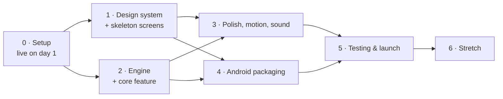

# Marquee — PLAN

**Project:** 08 · The No-Hassle Smart Media Player (codename *Marquee*) · **Status:** first build pass done 2026-09-29 — progress, verification and deviations in `docs/STATUS.md` · **Written:** 2026-09-06
**Reads with:** `GOAL.md` (what "done" means), `docs/ARCHITECTURE.md` (every §N reference below), `docs/DESIGN.md` (the visual contract), `docs/TESTING.md` (the golden tables), `_shared/DECISIONS.md` (D3 CI recipe, D9 working agreement).

## How to read this

- **Effort unit:** an *evening* ≈ 2 h, a *weekend day* ≈ 6 h. Every task is sized ≤ half a day (≤ 3 h). Where a task is bigger than that it has been split.
- **Acceptance criteria are literal.** If you cannot demonstrate it, the box does not get ticked.
- **D9.1 "day 1 = live"** is non-negotiable: Phase 0 ends with Marquee Lite on GitHub Pages, the Worker deployed, and a `v0.0.1` Release carrying a Windows zip and three APKs — before a single feature exists.
- **D9.2 "engine first"**: Phase 2 writes `lib/engine/` with tests and golden data *before* it gets a face. The Phase 1 screens are deliberately fed placeholder data.
- Tasks marked **⚑** are the Weekend MVP fast path (see the last section).

**Total rough effort:** ~38 evenings + ~10 weekend days (≈ 136 h) to `v1.0.0` — the sum of the six phase headers below (5+6+10+7+5+5 evenings, 1+2+3+2+1+1 weekend days; 76 h + 60 h). The Weekend MVP is **~16.5 h**, which is **two full 8-hour days**, not one evening plus a Saturday. Plan the time honestly.

**Phase dependency graph**

Phases 1 and 2 are genuinely parallel — the skeleton screens take placeholder models from §4, and the engine has no UI. If you only have short evenings, alternate: engine on weeknights (it is pure functions and unit tests), screens at the weekend (it needs a running app).

---

## Phase 0 — Setup: repo, tooling, CI, live hosting, secrets

**Goal:** three deployables exist, are automated, and are reachable from the internet or from your phone, with nothing in them yet. Also: kill the four unknowns that could invalidate the plan.

**Effort:** 5 evenings + 1 weekend day (~16 h).

- [ ] **0.1 ⚑ Create the public repo and the licence trail.** `marquee` on GitHub, MIT `LICENSE`, `.gitignore` (Flutter + Node + `*.p12`, `*.b64`, `.env`, **and the drift/build_runner output `**/*.g.dart` + `**/*.drift.dart` — generated code is never committed; CI regenerates it**), `LICENSES/` with LGPL-2.1, LGPL-3.0, ISC and OFL texts plus links to the two media_kit build-script repos. Copy `GOAL.md`, `README.md` and `docs/*` in as the first commit.
  *Acceptance:* `git log` shows one commit; the repo is public; `LICENSES/` has five files. **0.5 evening**
- [ ] **0.2 Day-1 API verification spike.** Create the OpenSubtitles consumer key and a free user account, then `curl` with the key to settle RESEARCH's open questions: (a) does `GET /utilities/guessit?filename=…` exist? (b) does `moviehash_match=only` work? (c) what is the download `link`'s TTL (fetch, wait 5/30/120 min, watch for 410)? (d) is there a per-second rate limit (fire 20 searches, read `X-RateLimit-*`)? (e) confirm `imdb_id 41959` / `tmdb_id 1092` for *The Third Man*.
  *Acceptance:* five answers appended to `docs/RESEARCH.md` §10 with the date; any that changes a design decision is reflected in ARCHITECTURE §9.1 in the same commit. **1 evening**
- [ ] **0.3 Decide the local dev loop.** Either install Flutter SDK + **Visual Studio 2022 Build Tools ("Desktop development with C++")** — the one local-toolchain exception `_shared/GETTING-STARTED.md` §1 allows — or commit to CI-only and read `flutter analyze`/test output from Actions. Record the choice at the top of `docs/DEPLOYMENT.md`.
  *Acceptance:* either `flutter doctor` shows Windows toolchain ✓, or `.github/workflows/ci.yml` runs `flutter analyze` on every push and you have used it once. **1 evening (or 0 if CI-only)**
- [ ] **0.4 ⚑ Scaffold the Flutter app and prove libmpv plays something.** `flutter create --org com.rahul --project-name marquee --platforms=windows,android .`; add `media_kit`, `media_kit_video`, `media_kit_libs_video`; a one-screen app with a file picker and a `Video` widget.
  *Acceptance:* a 1080p MKV plays with sound on Windows (locally or via a CI-built zip you download and run). **0.5 weekend day**
- [ ] **0.5 Pin the toolchain.** Commit `pubspec.lock`; pin Flutter in `.fvmrc` and in `subosito/flutter-action@v2` (`flutter-version:`, not `channel: stable`) so a Flutter release never breaks a tag build.
  *Acceptance:* `ci.yml` and `release.yml` both name the same exact Flutter version. **0.5 evening**
- [ ] **0.6 ⚑ Write `scripts/tokens.mjs`.** One source of truth (DESIGN §15) → `web/src/styles/tokens.css` + `lib/theme/tokens.dart`. Colours, type scale, spacing, radii, shadows, durations, easings, spring constants.
  *Acceptance:* `node scripts/tokens.mjs && git diff --exit-code` is clean; `Tokens.accent` in Dart equals `--accent` in CSS. **1 evening**
- [ ] **0.7 ⚑ Scaffold Marquee Lite.** `npm create vite@latest web -- --template vanilla-ts`; wire `base: process.env.VITE_BASE_PATH ?? '/'`; Fontsource variable fonts; `tokens.css`; a landing page with the lit `MARQUEE` sign and a drop frame that does nothing yet.
  *Acceptance:* `npm run build` succeeds; the page uses only token variables (no hard-coded hex). **0.5 evening**
- [ ] **0.8 ⚑ Go live on GitHub Pages.** Copy `_shared/templates/pages.yml`, edit it to build inside `web/`, set `VITE_BASE_PATH: /marquee/`; Settings → Pages → Source: GitHub Actions.
  *Acceptance:* `https://<owner>.github.io/marquee/` shows the lit sign on a phone browser. **0.5 evening**
- [ ] **0.9 ⚑ Deploy the Worker.** `worker/` from `_shared/templates/worker-proxy.ts`; `wrangler.toml` with `ALLOWED_ORIGIN` and `UPSTREAM_BASE`; `npx wrangler secret put OS_API_KEY`; copy `_shared/templates/worker.yml`.
  *Acceptance:* from the deployed Lite page's console, `fetch(WORKER + '/api/subtitles?languages=en&query=the%20third%20man')` returns JSON; the same fetch from `https://example.com` returns 403; an `OPTIONS` preflight returns 204. **1 evening**
- [ ] **0.10 Generate and register the signing key.** `bash _shared/scripts/make-keystore.sh marquee` **outside** the repo; add the four Android secrets plus `OS_API_KEY`, `CLOUDFLARE_API_TOKEN`, `CLOUDFLARE_ACCOUNT_ID`, optional `TMDB_READ_TOKEN` (that exact name — it is what `release.yml`, DEPLOYMENT §3.3 and the Worker all read).
  *Acceptance:* eight secrets listed in repo settings; the `.p12` and passphrase are in your password manager **and** one other place. **0.5 evening**
- [ ] **0.11 ⚑ Write `release.yml` and cut `v0.0.1`.** Two build jobs + a publish job (ARCHITECTURE §1.4): `windows-latest` → `flutter build windows --release` → `Compress-Archive`; `ubuntu-24.04` → `actions/setup-java@v6` (**Temurin 17** — this is a Flutter + AGP project, not Capacitor; it must match the `JavaVersion.VERSION_17` `compileOptions`/`kotlinOptions` in `android/app/build.gradle.kts`) → decode the keystore → `flutter build apk --release --split-per-abi`; publish with `softprops/action-gh-release@v3` + `SHA256SUMS.txt`. **Both build jobs run `dart run build_runner build --delete-conflicting-outputs` right after `flutter pub get` and before anything that analyses or compiles Dart** — `*.g.dart` is gitignored, so without it a tag build fails on a missing drift `part`. Rename the raw Flutter outputs to `marquee-<version>-<abi>.apk` / `marquee-<version>-windows-x64.zip` before upload, and assert no `app-release.apk` reaches the Release. Signing goes in `android/app/build.gradle.kts` using the env-driven PKCS12 pattern from `_shared/templates/app-build.gradle.snippet` (that template is Groovy/Capacitor — port it to Kotlin DSL, do not copy it verbatim).
  *Acceptance:* `git tag v0.0.1 && git push --tags` produces a Release with `marquee-<version>-windows-x64.zip` and three version-named APKs (`marquee-<version>-arm64-v8a.apk`, `…-armeabi-v7a.apk`, `…-x86_64.apk`) in **< 25 min**; the arm64 APK installs on the phone and plays a file. **0.5 weekend day**
- [ ] **0.12 Write `ci.yml`.** `flutter pub get` → **`dart run build_runner build --delete-conflicting-outputs`** (drift generates `lib/db/database.g.dart`; `*.g.dart` is gitignored, so on a fresh checkout `flutter analyze` fails on missing `part` files without this step — it must come **before** `flutter analyze` in every job that touches Dart, here and in `release.yml`) → `flutter analyze`, `flutter test --exclude-tags golden`, `cd web && npm ci && npm test -- --run`, `cd worker && npm ci && npm test`, and the tokens drift check from 0.6. Biome for `web/` + `worker/`, `flutter_lints` for Dart, `noConsole` rule scoped to `worker/`.
  *Acceptance:* a PR with `console.log` in `worker/index.ts` fails CI, and a fresh clone with no generated files still goes green (proving the codegen step runs early enough). **1 evening**
- [ ] **0.13 Write `scripts/make-fixtures.sh` and commit the fixtures.** The bit-exact ffmpeg recipes in TESTING §2.2 (eight media files + four text files), plus `test/fixtures/hashes.json`.
  *Acceptance:* running the script twice produces identical bytes; `make-fixtures.sh && git diff --exit-code test/fixtures` is a CI check. **1 evening**
- [ ] **0.14 Review `docs/DEPLOYMENT.md` against the repo as created.** The file already exists and is complete through §12 — the four deploy paths, the secret inventory, the tag ritual, keystore recovery and the `wrangler rollback` path. This task is the reconciliation pass: every path, workflow name, secret name and command in it must match what 0.1–0.13 actually produced, and any drift is fixed in the same commit.
  *Acceptance:* a stranger could deploy all four deployables from it alone, and every file path it names exists in the repo. **0.5 evening**
- [ ] **0.15 Timeboxed spike: the Windows `libmpv-2.dll` swap.** RESEARCH open question #3 — drop a current `mpv-dev-**lgpl**-x86_64-*.7z` DLL over the one `media_kit_libs_windows_video` ships (frozen at mpv git 0f78584, Oct 2024) and see whether the app still runs. **Two hours, then stop.** Ship the bundled DLL either way; record the result.
  *Acceptance:* a paragraph in RESEARCH §8 saying "works" or "does not work, symptom X", dated. **1 evening**

**Definition of done:** Lite is live at a public URL; the Worker proxies a real OpenSubtitles search; a GitHub Release carries a Windows zip and three signed APKs from one `git push --tags`; `ci.yml` is green; fixtures and tokens are generated and drift-checked; the four day-1 unknowns have written answers.

**Risks:**
| Risk | Mitigation |
|---|---|
| No OpenSubtitles key on day 1 blocks 0.2 and 0.9 | Create the account first, before anything else in this phase |
| Flutter Windows toolchain is a ~7 GB install | 0.3 explicitly allows the CI-only path; the APK is your real test device anyway |
| Cloudflare sign-up asking for a card ("no card" is experience, not documented) | If it does, stop (D9.5) and re-plan Lite around a "paste your own key" mode; the native tiers are unaffected |

---

## Phase 1 — Design system and skeleton screens

**Goal:** every screen in DESIGN §9 exists, is navigable, and looks like `design/preview.html` — fed entirely by placeholder data. No network, no libmpv beyond a still frame.

**Effort:** 6 evenings + 2 weekend days (~24 h). **Depends on:** 0.6 (tokens), 0.4 (app runs).

- [ ] **1.1 Verify `design/preview.html` renders at 390 px and 1440 px, and commit the four screenshots.** The visual contract (D9.3) already exists — 1 920 lines covering Lobby (night + Matinee), Threading mid-sweep, Auditorium with controls and the Booth sheet, built entirely on `tokens.css` values. This task is the check, not the build: open it at both widths, confirm the Matinee toggle and the signature interactions still work, confirm the candidate order matches the frozen scoring (A > D > C > B, TESTING §2.4), and commit one screenshot per screen to `design/`.
  *Acceptance:* four screenshots committed; every colour in the file resolves to a token; no hard-coded hex outside the `:root` blocks. **0.5 weekend day**
- [ ] **1.2 Wire `tokens.dart` into `ThemeData`** plus a `HouseTheme` inherited widget carrying the Auditorium/Matinee split and the `--house` value.
  *Acceptance:* `test/theme/tokens_test.dart` asserts every contrast pair in TESTING §2.12 within ±0.15. **1 evening**
- [ ] **1.3 Load fonts for tests.** `test/flutter_test_config.dart` registers Big Shoulders Display, Geist, Geist Mono and Noto Sans via `FontLoader`, sets the golden comparator tolerance to 0.5 %, and installs `Clock.fixed(2026-09-06T15:44Z)`.
  *Acceptance:* a trivial golden of the word `MARQUEE` renders in Big Shoulders, not Ahem. **0.5 evening**
- [ ] **1.4 Component primitives, batch A:** `Bulb` (off/on/warming/flicker), `MarqueeSign`, `Folio`, `Chip`, `ToggleBulb`, `UnderlineInput`, `SentenceBanner`.
  *Acceptance:* a widget-catalogue route shows all states; goldens committed for each. **0.5 weekend day**
- [ ] **1.5 Component primitives, batch B:** `TicketStrip` (static counts), `CandidateRow` (match / by-name / HI / selected / downloading), `FilmGate` (static, sprocket holes, buffered range, frame-in-gate playhead), `SyncRuleReadout`, `TransportMark`.
  *Acceptance:* goldens for every state listed in DESIGN §10. **0.5 weekend day**
- [ ] **1.6 Lobby skeleton.** Sky band, marquee sign, velvet rail with three placeholder cards, Open disc, doors drop target, attribution line, three ambience bulbs. Empty state included.
  *Acceptance:* matches the preview at phone and desktop widths; drag-over brightens the doors. **1 evening**
- [ ] **1.7 Threading skeleton.** Leader numeral with a conic-gradient sweep driven by a fake `Ticker`, hash line, candidate list, ticket strip, Skip link.
  *Acceptance:* a debug button steps 3 → 2 → 1 → flash; a second button freezes the sweep mid-numeral. **1 evening**
- [ ] **1.8 Auditorium skeleton.** Folio, black picture area, aisle lights, film gate, transport marks, sync readout; auto-hide after 2400 ms; every DESIGN §9.3 state reachable from a debug menu.
  *Acceptance:* controls hide and return; the folio stays at 40 %; keyboard focus rings visible on every mark. **0.5 weekend day**
- [ ] **1.9 Booth sheet + Ticket Office skeletons.** Sheet rises on the 380/32 spring to 70 %, drag-dismisses; Ticket Office rows, ticket strip, attribution block with the TMDB notice text and the OpenSubtitles credit.
  *Acceptance:* both match the preview; the sheet never exceeds 70 % so the frame stays visible. **1 evening**
- [ ] **1.10 Windows chrome.** `window_manager` frameless window; the marquee sign is the drag region; three bulb window controls; `flutter_acrylic` Mica **in the Lobby only**, opaque `#07060A` elsewhere.
  *Acceptance:* dragging the sign moves the window; maximise/restore/close work; the Auditorium is not translucent. **1 evening**
- [ ] **1.11 Lite skeleton.** The same four screens' worth of structure in `web/src/ui/`: landing with drop frame, leader overlay, No Print card, Booth sheet. Tokens only, no framework.
  *Acceptance:* Playwright screenshots of the landing match `design/preview.html` within the visual-diff threshold. **0.5 weekend day**
- [ ] **1.12 Accessibility and reduced-motion pass on the skeletons.** Focus rings on everything interactive, ≥ 44 × 44 px targets (gate 56 px), `role="slider"` + `aria-valuetext` on gate and sync rule, `aria-live` region for the leader, `MediaQuery.disableAnimations` / `prefers-reduced-motion` branches.
  *Acceptance:* `@axe-core/playwright` reports zero violations on Lite; Flutter `meetsGuideline(textContrastGuideline)` and `androidTapTargetGuideline` pass. **1 evening**

**Definition of done:** you can walk Lobby → Threading → Auditorium → Booth → Ticket Office and back with placeholder data on Windows and in the browser; goldens exist for every component state; the app does not look worse than `design/preview.html`.

**Risks:** the beam shader is *not* in this phase (Phase 3) — resist starting it, because a half-built shader makes every golden unstable. `flutter_acrylic` is two years old; if Mica misbehaves on the current Flutter, drop to a flat `--bg` Lobby and note it (it is decoration, not a feature).

---

## Phase 2 — Engine and the core feature

**Goal:** GOAL §5 criteria **1 (zero-click subtitles)**, **3 (a ticket is never wasted)** and **4 (honest loading)** are demonstrably true on Windows and in Lite. Pure logic first, with golden tests, then wired to the Phase 1 screens.

**Effort:** 10 evenings + 3 weekend days (~38 h). **Depends on:** 0.13 (fixtures), 0.2 (API answers). Parallel with Phase 1.

### 2a. `lib/engine/` — pure Dart, no Flutter imports

- [ ] **2.1 ⚑ `hash.dart` + `hash_test.dart`** (ARCHITECTURE §6.1, TESTING §2.1). Include the `no_flutter_imports_test.dart` guard.
  *Acceptance:* all seven vectors pass, including `0xFF`×131 072 → `000000000001c000`, the 131 071-byte `FileTooSmall`, and V7 (a stub source reporting `size = 2³²` → `0000000100000000`, which is what catches 32-bit seek truncation on files over 4 GB); **100 % line coverage**. **1 evening**
- [ ] **2.2 `filename.dart` + goldens** (§6.2, TESTING §2.3) — the parse-torrent-title port, anime brackets included.
  *Acceptance:* all eight golden filenames produce the exact expected records, including `movie.mkv → confidence: low`. **0.5 weekend day**
- [ ] **2.3 ⚑ `scoring.dart` + goldens** (§6.3, TESTING §2.4).
  *Acceptance:* the A/D/C/B/E ranking reproduces to 2 decimal places; `machine_translated` is listed but `autoPick: false`; the list is ordered, never filtered. **1 evening**
- [ ] **2.4 `timecode.dart`, `sync_rule.dart`, `detents.dart` + goldens** (§6.6–6.8, TESTING §2.7–2.8).
  *Acceptance:* `4364.4 / 9663 → 01:12:44 · −01:28:19`; `+0.376 → +0.40` (round, not floor); the 152 px / 160 px detent pair behaves as specified. **1 evening**
- [ ] **2.5 `tickets.dart` + goldens** (§6.9, TESTING §2.6).
  *Acceptance:* all seven quota inputs produce the exact strip text, colour, state and aria-label; `allowed_downloads` is never hard-coded. **0.5 evening**
- [ ] **2.6 `srt.dart` + goldens** (§6.10, TESTING §2.5) — BOM, CRLF, out-of-order cues, `<i>`, `{\an8}`, shift with clamp.
  *Acceptance:* `sample-crlf-bom.srt` converts byte-for-byte to the expected VTT. **0.5 evening**
- [ ] **2.7 ⚑ `threading.dart` state machine + tests** (§6.5).
  *Acceptance:* every transition in the state diagram is covered; a rejected phase freezes `sweep` at its current value and publishes the correct `next[]`; `FileTooSmall` produces **no** error UI; exactly one automatic retry exists (410). **0.5 weekend day**

### 2b. `lib/api/` and `lib/db/`

- [ ] **2.8 ⚑ `opensubtitles.dart` + `net.dart` against `MockClient`.** Sorted params, mandatory headers, `Retry-After` handling, 401/406/410/429 → typed `ThreadingFailure`.
  *Acceptance:* a test asserts the outgoing query string is alphabetically sorted; the fixture JSONs in TESTING §2.9 all parse. **1 evening**
- [ ] **2.9 `subdl.dart`** — keyed search, **anonymous** zip download, in-memory unzip with the size/traversal guards from ARCHITECTURE §10.
  *Acceptance:* the `subdl-zip.bin` fixture yields one `.srt`; a zip with a `../` entry is rejected. **1 evening**
- [ ] **2.10 drift schema, DAOs, code generation and migration test.** The eight tables in §4 (the seven data tables plus `app_state`), `schemaVersion: 1`, `NativeDatabase.memory()` tests. drift is **code-generated**: `dart run build_runner build --delete-conflicting-outputs` writes `lib/db/database.g.dart`, and **`*.g.dart` / `*.drift.dart` are gitignored, never committed** — CI regenerates them after every `flutter pub get` and before `flutter analyze` (0.12).
  *Acceptance:* `hash_cache` lookups are indexed; the artwork expiry sweep deletes rows older than 180 days; a `liveQuery`-style `watch()` drives a list; a round-trip of `window_bounds` and `seen_gate_nudge` through `app_state` survives a simulated restart; and a fresh clone passes `flutter pub get && dart run build_runner build --delete-conflicting-outputs && flutter analyze`. **1 evening**

### 2c. Player and wiring

- [ ] **2.11 ⚑ `player/engine.dart`.** `MediaKit.ensureInitialized()`, `PlayerConfiguration(libass: true, …)`, `VideoControllerConfiguration(enableHardwareAcceleration: true)`, open/close lifecycle, position/duration/buffering streams throttled to 10 Hz, `container-fps` and `chapter-list` reads, `sub-delay` writes.
  *Acceptance:* all twelve corpus files (GOAL §5.2) play on Windows with hardware decode; `chapter-list` populates the gate detents. **0.5 weekend day**
- [ ] **2.12 `player/tracks.dart`** — enumerate embedded audio and subtitle tracks, switch them, attach an external `SubtitleTrack.uri(path)`.
  *Acceptance:* the fixture MKV's embedded SRT and ASS tracks both list and both render (ASS with correct `\pos` and `\an8`). **1 evening**
- [ ] **2.13 ⚑ Wire Threading to the real machine.** Riverpod `threadingProvider`; the leader's sweep is driven by real promises; candidate rows come from `scoring.dart`; the ticket strip from the real `/download` response.
  *Acceptance:* opening a hash-hit file lights the MATCH bulb and shows a real `remaining`; killing the network mid-search freezes the numeral and slides in the fallback rows. **0.5 weekend day**
- [ ] **2.14 ⚑ Sidecar write + `hash_cache`.** Save as `<video>.<lang>.srt` beside the file (with the `.1` collision rule), record the cache row, and check sidecar → cache → network in that order on every open.
  *Acceptance:* reopening the same file uses **0** downloads and shows the same MATCH state; deleting the sidecar but keeping the row prompts a re-fetch, not a crash. **1 evening**
- [ ] **2.15 Ticket Office sign-in.** Username/password → `/login` → JWT in `flutter_secure_storage`; password never retained; 401 → "Ticket expired — sign in again"; quota from `user.allowed_downloads`; sign-out clears the token.
  *Acceptance:* the strip changes from `ANONYMOUS · 5 PER DAY PER IP` to `n OF <allowed> TONIGHT` after signing in. **1 evening**
- [ ] **2.16 Keyboard cue sheet.** One **`design/cue-sheet.json`** (that exact path — DEPLOYMENT §1, TESTING I11/G10 and IMPLEMENTATION-PROMPT §2.8 all name it) feeding both the `?` overlay and the README; bind every shortcut in DESIGN §9.3. Because it lives in `design/` and not `assets/`, it must be listed explicitly in `pubspec.yaml`'s `flutter: assets:` block or the runtime overlay cannot read it.
  *Acceptance:* every listed key works on Windows; the overlay is generated from the JSON, not hand-written; `design/cue-sheet.json` appears in `pubspec.yaml`'s asset list. **0.5 evening**

### 2d. Web tier and Worker

- [ ] **2.17 ⚑ Port the engine to TypeScript.** `osHash.ts`, `srt2vtt.ts`, `scoring.ts`, `tickets.ts`, `timecode.ts`, `syncRule.ts`, `capability.ts` — sharing the *same* golden tables as the Dart suite.
  *Acceptance:* Vitest reproduces every Dart golden; a mismatch fails CI in both suites. **0.5 weekend day**
- [ ] **2.18 ⚑ Harden the Worker to ARCHITECTURE §9.4.** Param sorting, `/api/subtitle-file` host allow-list + 2 MB cap, `/download` requires `Authorization`, per-IP 60/min counter, header passthrough, no logging.
  *Acceptance:* `worker/test/worker.test.ts` covers every invariant, including "the key never appears in any response". **1 evening**
- [ ] **2.19 ⚑ Lite end-to-end.** Drop → capability probe → `osHash` → Worker search → auto-pick → download → SRT→VTT `<track>` → play. JASSUB lazy-loaded for `.ass`. IndexedDB cache so a reopen is free and works offline.
  *Acceptance:* GOAL §5.7 — an MP4/H.264 plays with subtitles in **< 3 s**; an unplayable file shows the No Print card naming the missing decoder in **< 1 s**. **0.5 weekend day**
- [ ] **2.20 Lite sign-in + ticket strip.** Login through the Worker; JWT sealed with a non-extractable WebCrypto key; "this session only" option.
  *Acceptance:* the strip shows real quota; refusing to store the token keeps it in memory only. **1 evening**

**Definition of done:** on Windows, dropping a hash-matched 1080p MKV attaches synced English subtitles with **zero clicks in under 3 s**; reopening it costs **zero** downloads; unplugging the network stalls the leader at "2" with a sentence and a working "Play without subtitles"; the same ritual works in Lite for browser-playable codecs. Engine coverage: 100 % on `hash`, `scoring`, `timecode`, `sync_rule`, `tickets`; ≥ 90 % on the rest of `lib/engine`.

**Risks:**
| Risk | Mitigation |
|---|---|
| The free quota (~10/day) makes manual testing painful | `hash_cache` from 2.14 first; use the fixture JSONs for everything except a handful of live checks; `GET /infos/user` reads quota without spending |
| Download `link` expiry unknown (0.2 answers it) | Always store the file, never the link; the single 410 retry in §6.5 |
| Dart's 64-bit wrap behaviour differs on the web target | `hash.dart` is native-only by construction (`RandomAccessFile`); the TS port uses BigInt. The `no_flutter_imports` guard plus separate goldens keep them honest |
| Scoring weights turn out wrong in real use | They live in one function with one golden table; changing them is a two-file commit (TESTING §2.4 says so explicitly) |

---

## Phase 3 — Polish, motion, sound

**Goal:** the app becomes HOUSE LIGHTS. Every signature interaction in DESIGN §8 is real, and a screenshot of the running app is indistinguishable from `design/preview.html`.

**Effort:** 7 evenings + 2 weekend days (~26 h). **Depends on:** Phase 1 (screens) + Phase 2 (real state to light up).

- [ ] **3.1 The `--house` system.** One `houseProvider` double tweened 1 → 0 over 900 ms on `--ease-house`, driving wall luminance, sky opacity, bulb intensity and beam width simultaneously; reversed on leaving the Auditorium; 240 ms crossfade under reduced motion.
  *Acceptance:* dropping a file visibly dims the room before the leader starts; one value drives all four properties (grep proves there is no second tween). **1 evening**
- [ ] **3.2 `beam.frag`.** Soft cone in `--accent` at 8–14 % alpha, 3-octave value noise, ~200 dust sprites; uniforms `angle`, `width`, `time`, `house`; DPR capped 1.5 desktop / 1.0 Android; paused on `visibilitychange` and during playback; **static radial-gradient fallback** on shader failure or reduced motion.
  *Acceptance:* ≤ 2 ms/frame measured in `perf_test.dart`; killing the shader asset falls back without an exception. **0.5 weekend day**
- [ ] **3.3 Bias light.** `bias_light.dart` (§6.4) + the throttled screenshot sampler (500 ms desktop, 1000 ms Android, top-80 % crop) + the 5-stop wall gradient with the 600 ms `bias-lerp`.
  *Acceptance:* TESTING §2.11 goldens pass; an all-black frame keeps `--focus` at 6 %; sampling stops when paused; ≤ 2 ms per sample. **0.5 weekend day**
- [ ] **3.4 Film gate, full.** Chapter/5-min detents with the 6 px capture radius, spring snap, FINE mode (drag up, 1/8 gain), first-run 12 px nudge, buffering flicker at 2 Hz, selection haptics.
  *Acceptance:* the TESTING §2.8 detent table reproduces on a real drag; the nudge fires once and is remembered. **1 evening**
- [ ] **3.5 Thumbnail strip in the gate.** A second muted `hwdec=no` player builds a cached JPEG strip after open; if it stalls for > 3 s, fall back to timecode-only silently.
  *Acceptance:* dragging pulls thumbnails through the gate on Windows; on Android the fallback engages without jank. **1 evening**
- [ ] **3.6 Sync rule UI.** The mono ruler under a fixed tungsten caret, 50 ms detents with selection haptics, `J`/`K` and `Shift` steps, long-press reset, per-hash memory surfaced as the `±0.35` Lobby chip.
  *Acceptance:* the value is written live to mpv `sub-delay`; reopening the same file restores it; a different hash starts at 0.00. **1 evening**
- [ ] **3.7 Ticket tear.** `clip-path` tear + medium haptic + paper-rip sound; the count decrements **after** the animation (`pendingTear`); at 2 left the strip turns crimson with the sign-in / Subdl sentence.
  *Acceptance:* a widget test asserts the decrement order; the crimson state is the only crimson element on that screen. **0.5 evening**
- [ ] **3.8 Marquee warm-up, sky band, night flicker.** Title spelled letter by letter (60 ms stagger, capped at 24 letters), sky band from the injected clock, 0.5 % bulb flicker at local night, Matinee palette for Lobby/Booth/Ticket Office only.
  *Acceptance:* with the clock fixed at 21:14 IST the bulbs are lit and flickering; at 11:00 they are painted and the sky is full strength. **1 evening**
- [ ] **3.9 Sound and haptics.** `flutter_soloud`: CC0 projector-loop room tone (−30 dB, 120 Hz high-pass, starts on first gesture), synthesised 900 ms sine sweep, 33 ms 1 kHz 2-pop, 4 ms detent click, CC0 paper rip. Haptic map from DESIGN §12. One bulb each in the Ticket Office; silent during playback; honours the OS silent switch.
  *Acceptance:* every event in the DESIGN §12 table fires once and only once; turning both bulbs off makes the app silent and still. **1 evening**
- [ ] **3.10 Booth sheet, full.** Track list (external / embedded / off), style presets S/M/L + outline applied live via mpv `sub-*`, position (bottom / lower-third / top), the sync rule, "Find another print" (re-runs rungs 3–4 without leaving the sheet), ticket count.
  *Acceptance:* changing size or outline updates the paused frame immediately; "Find another print" never closes the sheet. **0.5 weekend day**
- [ ] **3.11 TMDB posters and per-title accent.** `/find/{imdb_id}` → poster/backdrop; `material_color_utilities` → per-title accent; `artwork.expires_at = +180 days` with a startup sweep; the TMDB logo and the exact required notice rendered wherever artwork appears.
  *Acceptance:* disabling TMDB removes every network call to it *and* the logo; an artwork row older than 180 days is deleted on launch. **1 evening**
- [ ] **3.12 Lite motion parity.** House-down as a CSS `@property --house` tween, View Transition on library → player, JASSUB canvas over the video, `requestVideoFrameCallback` bias light, Howler + Web Audio for the same sound set.
  *Acceptance:* Playwright visual specs match the preview; `prefers-reduced-motion` kills dust and parallax but keeps the honest leader. **0.5 weekend day**
- [ ] **3.13 Grain, shadows, one-accent audit.** SVG `feTurbulence` / tiled noise at `--grain-opacity` in the Lobby and sheets only (0 in the Auditorium); every shadow falls down; a manual sweep for "more than one accent per screen".
  *Acceptance:* no grain over the picture; the crimson budget rule holds on every screen. **0.5 evening**

**Definition of done:** side-by-side, the running app and `design/preview.html` are indistinguishable at phone and desktop widths; 60 fps during playback with the beam and bias light on; the reduced-motion build still stalls the leader honestly.

**Risks:** shader work is the classic time sink — 3.2 is timeboxed to half a weekend day, and the static fallback means shipping without it is always an option. Bias light on Android is the unmeasured one (RESEARCH §8); it stays **opt-in on Android** until 4.9 measures it.

---

## Phase 4 — Android packaging and the phone experience

**Goal:** the APK is a first-class citizen, not a port: gestures, PiP, edge-to-edge, predictive back, library from MediaStore, and subtitles that actually render.

**Effort:** 5 evenings + 1 weekend day (~16 h). **Depends on:** 0.11 (signed release pipeline), Phase 2, Phase 1.

- [ ] **4.1 Manifest and build config.** `minSdk 26`, `compileSdk 36`, `targetSdk 36`, the two intent filters, `supportsPictureInPicture`, `resizeableActivity`, `enableOnBackInvokedCallback`, the `configChanges` list, `READ_MEDIA_VIDEO` (+ `maxSdkVersion 32` legacy).
  *Acceptance:* "Open with → Marquee" appears for an MKV in a file manager; rotating during playback does **not** restart libmpv. **1 evening**
- [ ] **4.2 ⚑ libass on the device.** Bundle `NotoSans-Regular.ttf`; `libassAndroidFont` + `libassAndroidFontName: 'Noto Sans'` (the TTF's internal family name); keep `vo=gpu` and `hwdec=auto-safe` — never `mediacodec_embed`.
  *Acceptance:* the fixture `.ass` renders with correct `\pos` and `\an8` on a real phone, identical to Windows. **1 evening**
- [ ] **4.3 `PipChannel.kt`.** `enterPictureInPictureMode` with the video's aspect ratio and `setAutoEnterEnabled(true)`; `onPictureInPictureModeChanged` pushed to Dart so all chrome drops.
  *Acceptance:* pressing home during playback enters PiP with no controls; returning restores the full Auditorium at the same position. **1 evening**
- [ ] **4.4 `MediaStoreChannel.kt` + SAF grants.** Paged video query (500 at a time) for the library; `OPEN_DOCUMENT_TREE` with `takePersistableUriPermission` for chosen folders stored in `folders.grant_blob`.
  *Acceptance:* the Lobby rail fills from the phone's videos without a full-storage permission; a granted folder still works after a reboot. **0.5 weekend day**
- [ ] **4.5 Edge-to-edge, insets and back.** `edgeToEdge` in the Lobby, `immersiveSticky` while controls are hidden, `SafeArea` for the marquee and controls, picture under the cutout in landscape, predictive back registered by the Booth sheet and Threading.
  *Acceptance:* nothing sits under the status/navigation bars; the predictive-back preview shows the room, not a blank page. **1 evening**
- [ ] **4.6 Gestures and haptics.** Single tap = controls; double-tap thirds = ∓10 s; long-press = 2× while held; vertical edge drags = brightness/volume with mono readouts (brightness restored on exit); horizontal drag = scrub starting 24 px inside the edges; pinch = fit/fill.
  *Acceptance:* the back gesture never fires while scrubbing; brightness returns to the system value after leaving. **1 evening**
- [ ] **4.7 Splash, icon, keep-awake.** `flutter_native_splash` (`#07060A` + a 72 dp lit bulb, Android 12+ animated icon with a 300 ms warm-up); adaptive icon foreground/background/monochrome; `wakelock_plus` during playback only.
  *Acceptance:* the launcher icon is legible at 48 dp in themed-icon mode; the screen never sleeps mid-film and does sleep in the Lobby. **0.5 evening**
- [ ] **4.8 Update-over-install proof.** Tag `v0.1.0` after `v0.0.1` and install the new arm64 APK over the old one.
  *Acceptance:* it installs without an uninstall prompt and the library, resume points and sign-in survive. **0.5 evening**
- [ ] **4.9 Measure the unmeasured.** RESEARCH open question #5: play a 1080p HEVC file with libass on for 20 minutes on the phone; record battery drain, sustained fps and case temperature; repeat with subtitles off.
  *Acceptance:* three numbers written into RESEARCH §8, dated — and a decision recorded in 4.10. **1 evening**
- [ ] **4.10 Set the Android ambience defaults from 4.9.** Bias light and beam default **on** only if 4.9 shows < 5 % extra drain over 20 min; otherwise both default off with a one-line explanation in the Ticket Office.
  *Acceptance:* the default matches the measurement, and the Ticket Office says why. **0.5 evening**

**Definition of done:** the arm64 APK plays the full twelve-file corpus with hardware decode and correct ASS rendering, does PiP, respects the back gesture, fills its library from MediaStore, installs over the previous version, and stays under the thermal/battery bar you measured.

**Risks:** `libassAndroidFontName` mismatches are the classic silent failure (invisible subtitles) — 4.2 verifies the *internal* family name, not the filename. APK size is ~30–40 MB per ABI, which is why `--split-per-abi` is mandatory and arm64-v8a is the headline asset.

---

## Phase 5 — Testing, hardening and launch

**Goal:** `v1.0.0` with every GOAL §5 criterion demonstrated, the licence trail complete, and the test suite guarding all three tiers.

**Effort:** 5 evenings + 1 weekend day (~16 h). **Depends on:** Phases 3 and 4.

- [ ] **5.1 Reconcile `docs/TESTING.md` with what actually shipped.** The file is complete — suite-by-suite plans, the live contract test, performance gates, accessibility, the manual Android and Windows checklists and the CI matrix are all written. This task is the reconciliation: every §N cross-reference resolves, and every golden number that moved during the build moved in the doc **in the same commit** that moved it in code.
  *Acceptance:* every "§N" reference inside TESTING.md resolves to a section that exists, and `flutter test` + Vitest reproduce every golden table in it verbatim. **1 evening**
- [ ] **5.2 `integration_test/` on `windows-latest`.** `player_test`, `subtitles_test`, `seek_test`, `keyboard_test`, `house_test`, `perf_test` against real libmpv and the committed fixtures.
  *Acceptance:* the suite runs in `release.yml` before the artifacts are published and fails the tag on a regression. **0.5 weekend day**
- [ ] **5.3 Playwright suites.** `lite`, `playback`, `threading`, `subtitles`, `noprint`, `offline`, `keyboard`, `a11y`, `visual/*`, `perf/*` across `chrome`, `firefox` and a `pixel-7` profile, with the Worker mocked by `page.route`.
  *Acceptance:* green on PRs; visual diffs reviewed by eye; the codec-line assertions match TESTING §2.10's per-browser certainties. **0.5 weekend day**
- [ ] **5.4 Nightly `contract.yml`.** The live OpenSubtitles shape check, skipped when `OS_API_KEY` is absent, asserting every field the app reads still exists.
  *Acceptance:* deleting a field from a fixture makes it fail; a green nightly run is visible in Actions. **0.5 evening**
- [ ] **5.5 Performance gates in CI.** APK/zip size limits, Lighthouse CI budget, bundle-size check, Flutter timeline summary thresholds (ARCHITECTURE §11).
  *Acceptance:* adding a 5 MB asset to `web/` fails the build with a clear message. **1 evening**
- [ ] **5.6 Manual device passes.** The Android checklist (permissions, rotation, PiP, audio focus, back gesture, libass, battery) on the phone, and the Windows checklist (frameless drag, Mica scope, SmartScreen on first run, keyboard map, `--verbose` log) on the PC — both against the tag's own artifacts, not a dev build.
  *Acceptance:* both checklists signed off in the release PR. **1 evening**
- [ ] **5.7 Licence and attribution audit.** `LICENSES/` complete; the About page lists libmpv/ffmpeg/libass LGPL notices with links to the two build-script repos; "Subtitles by OpenSubtitles.com" present; TMDB logo + exact notice present when TMDB is on; every font OFL credited; confirm the shipped Android flavour is `default` (never `encoders-gpl`) and the Windows DLL is an LGPL build.
  *Acceptance:* a checklist in the release PR, each item with the file and line that satisfies it. **1 evening**
- [ ] **5.8 Ship `v1.0.0`.** Release notes generated plus a hand-written summary; README screenshots from the real app; the Lite landing linking to the Release; DEPLOYMENT.md's rollback path exercised once on the Worker.
  *Acceptance:* a stranger can download the zip or APK from the Releases page, open a file, and get synced subtitles with zero clicks. **0.5 evening**

**Definition of done:** all eight GOAL §5 criteria demonstrated and recorded; three test suites green; the licence trail auditable; `v1.0.0` public.

**Risks:** the two things CI can never prove are Android battery behaviour and real browser codec support — both are manual checklist items by design (5.6), not gaps.

---

## Phase 6 — Stretch

Nothing here blocks `v1.0.0`. Pick by appetite; each is independently shippable.

- [ ] **6.1 Audio-based automatic sync.** ffsubsync-style cross-correlation of speech energy (from a decoded audio window) against cue timing, producing a suggested offset the sync rule pre-loads. Procedural, no ML. **~2 weekend days**
- [ ] **6.2 `glsl-shaders` presets (Windows).** Anime4K (MIT) and an interpolation/`tscale` toggle in the Ticket Office; HDR tone-mapping controls. **1 evening**
- [ ] **6.3 CI step to refresh the Windows `libmpv-2.dll`** from zhongfly's `mpv-dev-**lgpl**-x86_64-*` build — only if 0.15 said it works; keep the shipped DLL as a fallback artifact. **1 evening**
- [ ] **6.4 "Indic subtitles" font pack.** Downloadable Noto Sans Devanagari/Tamil into the libass fonts dir, since `sub-font-provider=none` on Android means only bundled fonts exist. **1 evening**
- [ ] **6.5 Lite WebCodecs path.** `movi-player` or `mediabunny` behind the "Try the WebCodecs path" button for MKV/HEVC/AC-3 in Chromium/Safari; keep it a dynamic import and never on the critical path. **1 weekend day**
- [ ] **6.6 Playlists, "play next in folder", A–B loop polish, frame-step refinements.** **1 weekend day**
- [ ] **6.7 Inno Setup installer + Windows file associations** (`inno_bundle`), so `.mkv` can open in Marquee by double-click. **1 evening**
- [ ] **6.8 Rive wordmark and gesture feedback.** **1 evening**
- [ ] **6.9 COOP/COEP for JASSUB threading** by moving Lite to Cloudflare Workers static assets (the D2 escape hatch — GitHub Pages cannot send custom headers). **1 evening**

Explicitly **not** on this list, ever (GOAL §6): streaming, torrents, DLNA, a media server, transcoding, accounts of our own, LLM features, store listings.

---

## Weekend MVP fast path (16.5 hours — two full days)

Sixteen and a half hours — the exact sum of the fourteen rows below — in this order, skipping everything else. That is two 8-hour days, not one weekend evening plus a Saturday; book the time honestly. The result: a Windows build (and an APK from CI) that plays any file and fetches synced subtitles with zero clicks, plus a live Lite page that does the same for browser codecs.

| # | Task | Why it is on the path | Time |
|---|---|---|---|
| 1 | **0.1** Repo + MIT + licences | Nothing works without it | 0.5 h |
| 2 | **0.6** `scripts/tokens.mjs` | Both tiers need tokens before any UI | 1 h |
| 3 | **0.4** `flutter create` + media_kit, plays a file | The engine, proven | 2 h |
| 4 | **0.7 + 0.8** Lite scaffold → live on GitHub Pages | D9.1: day 1 = live | 1 h |
| 5 | **0.9** Worker deployed with the key | Lite cannot call OpenSubtitles without it | 1 h |
| 6 | **0.11** `release.yml` + `v0.0.1` tag | An APK on your phone the same day | 1.5 h |
| 7 | **2.1** `hash.dart` + its seven golden vectors | The whole idea rests on this function | 1 h |
| 8 | **2.3** `scoring.dart` + goldens | Picking the *right* subtitle is the feature | 1 h |
| 9 | **2.8** `opensubtitles.dart` (sorted params, headers, error mapping) | The only mandatory API | 1 h |
| 10 | **2.7** `threading.dart` state machine | Makes the leader honest instead of decorative | 1.5 h |
| 11 | **2.11 + 2.13** Player wiring + Threading on real promises | Drop → leader → subtitles, end to end | 2 h |
| 12 | **2.14** Sidecar write + `hash_cache` | A ticket is never wasted twice | 0.5 h |
| 13 | **2.17 + 2.19** TS engine port + Lite end to end | The mandatory web tier actually does the ritual | 2 h |
| 14 | **4.2** libass font on Android | Without it, subtitles are invisible on the phone | 0.5 h |

**What the MVP deliberately lacks:** the beam, bias light, the marquee warm-up, the film-gate thumbnails, the ticket-tear animation, sound, the Matinee palette, the library rail, TMDB posters, Subdl, PiP and gestures. It looks plain — but the leader still counts 3-2-1 honestly, the controls still auto-hide, and the one thing the project exists for already works. Everything after that is Phases 1 and 3 making it beautiful.

